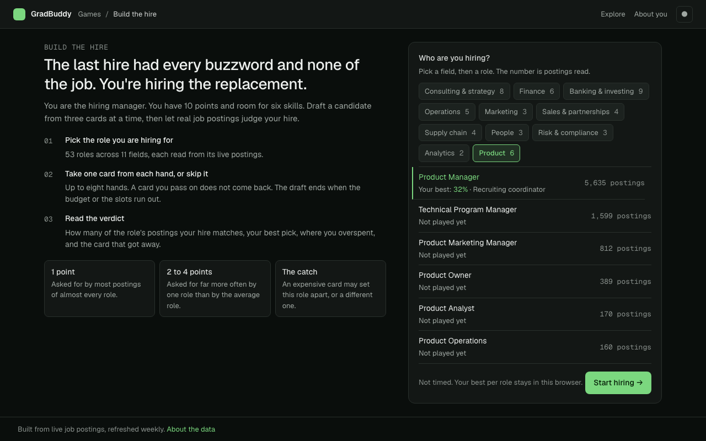
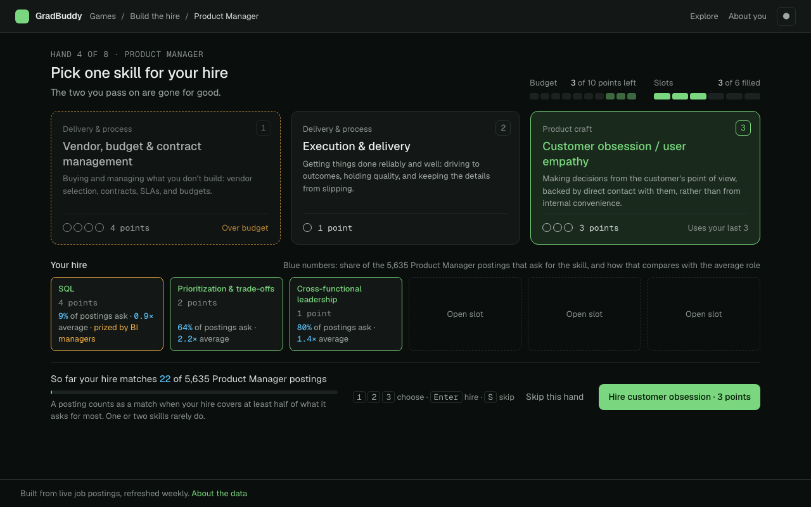
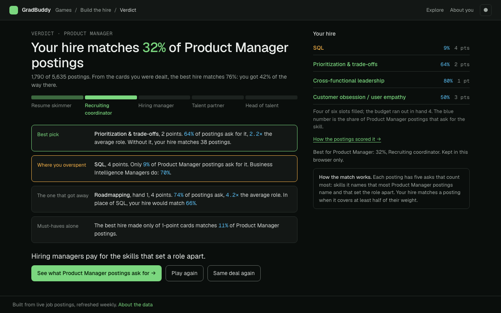
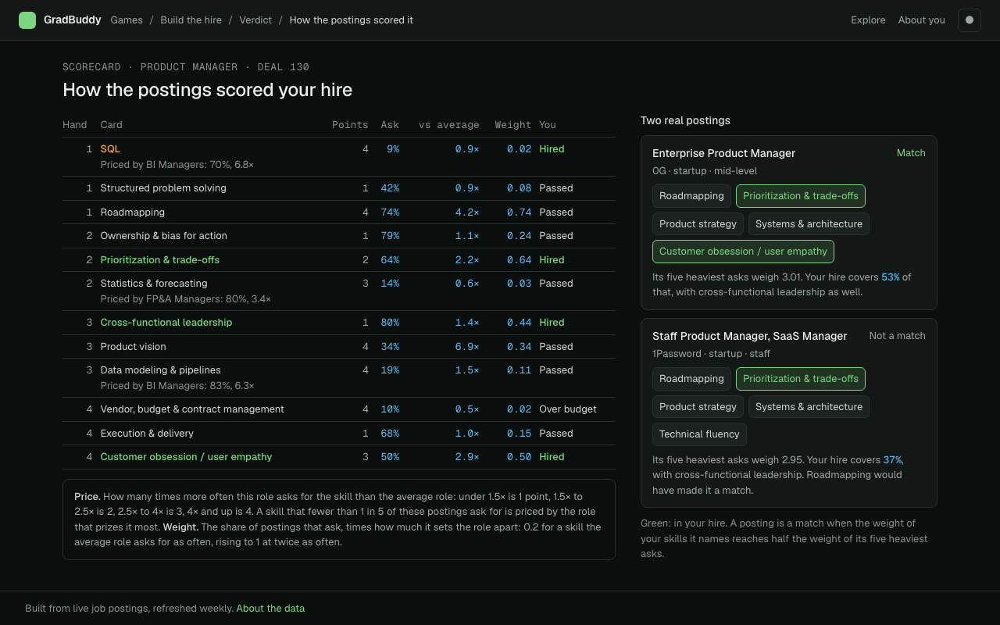

# Build the hire

```json
{ "slug": "build-the-hire", "title": "Build the hire", "tagline": "Draft a hire, then let postings judge", "cover": "img/games/build-the-hire.png", "status": "soon" }
```

`web/data/games.json` already lists this slug with the tagline "Be the hiring manager for a day"; the entry above
keeps its shape and proposes a tagline that says what you do.

Design package for one game of the role atlas: rules, the numbers behind them, four high-fidelity screens and a
build prompt (`PROMPT.md`). Nothing here is built. Every number below comes from the repo data through
`scripts/compute.js` (read-only; `node games/build-the-hire/scripts/compute.js`, add `--all` for the every-role
tables). Data as of `graph_mba.json` generated 2026-10-14 and `graph.json` generated 2026-10-11.


## Pitch

> The last hire had every buzzword and none of the job. You're hiring the replacement.

You are the hiring manager for one role, say Product Manager. You have 10 points and room for six skills. Each
hand offers three skill cards; you hire one or skip the hand, and the cards you pass on are gone. Cheap cards are
the skills every role asks for. Expensive cards are the skills one role asks for far more than the average role:
sometimes yours, sometimes a different role's. When the budget or the slots run out, the role's real postings
judge your hire: "Your hire matches 32% of Product Manager postings", your best pick, where you overspent ("SQL,
4 points. Only 9% of Product Manager postings ask for it"), the card that got away, and the line the game exists
to make: **Hiring managers pay for the skills that set a role apart.** Then "See what Product Manager postings ask
for →" opens `#/role/pm`.

It borrows the role-play framing of infisical.com/403 most directly: you are given a job, one verb (hire), short
rounds, choices you cannot take back, a rank title, a personal best, and an ending that is the product's point.

## Why it is fun

- **A role reversal.** Students spend the year being judged by hiring managers. Here they sit on the other side
  and find out what the job's postings actually pay for.
- **One verb, real tension.** Ten points over six slots is 1.7 points a slot. The skills that set a role apart cost
  3 or 4. You cannot have them all, and filling slots with 1-point cards barely moves the score.
- **The expensive card is a riddle.** A 4-point card is either your role's signature skill or another field's.
  SQL for a Product Manager and Roadmapping for a Product Manager cost the same 4 points; one is in 9% of the
  postings, the other in 74%.
- **Instant feedback, permanent stakes.** Each hire reveals the postings' numbers at once (blue). Passed cards do
  not return, so the verdict can name the one that got away.
- **Short and replayable.** At most eight decisions, about two minutes, not timed. 53 roles, a shareable deal
  number, a best score per role, five rank titles.

## Rules

1. Pick a role (53 roles in 11 fields; the brief screen).
2. You start with **10 points** and **6 empty slots**.
3. Up to **8 hands** of **3 cards**. Hire one card you can afford, or skip the hand. A card you see once is never
   dealt again, hired or not.
4. Each card shows its skill area (text), name, the atlas's one-line definition, and its price (1 to 4 points).
   It does not show how many postings ask for it; that is revealed when you hire it.
5. A card that costs more than you have left is shown but cannot be hired ("Over budget").
6. The draft ends when the slots are full, the points are spent, or the eighth hand is played.
7. The verdict scores the hire against every posting of the role.

## A draft, step by step (a real deal)

Product Manager, deal 130, played by the example player in `scripts/compute.js` (takes SQL when it is offered
early, otherwise the strongest card that leaves room). 5,635 postings at 1,161 companies.

| Hand | Points left | On offer (price · share of PM postings · times the average role) | Hired | Matches so far |
|---|---|---|---|---|
| 1 | 10 | SQL (4 · 9% · 0.9×), Structured problem solving (1 · 42% · 0.9×), Roadmapping (4 · 74% · 4.2×) | SQL | 0 postings |
| 2 | 6 | Ownership & bias for action (1 · 79% · 1.1×), Prioritization & trade-offs (2 · 64% · 2.2×), Statistics & forecasting (3 · 14% · 0.6×) | Prioritization | 0 |
| 3 | 4 | Cross-functional leadership (1 · 80% · 1.4×), Product vision (4 · 34% · 6.9×), Data modeling & pipelines (4 · 19% · 1.5×) | Cross-functional | 22 (0.4%) |
| 4 | 3 | Vendor, budget & contract management (4, over budget), Execution & delivery (1 · 68% · 1.0×), Customer obsession / user empathy (3 · 50% · 2.9×) | Customer obsession | 1,790 (31.8%) |

The budget runs out in hand 4 with two slots empty. Verdict: **32% of Product Manager postings** (1,790 of 5,635).
The best hire that could be built from the twelve cards dealt (Roadmapping, Prioritization, Cross-functional
leadership, Ownership, Execution, Structured problem solving; 10 points) matches 75.7%, so the player got 42% of the
way: **Recruiting coordinator**. Best pick: Prioritization (without it the hire matches 38 postings). Overspent:
SQL (removing it changes nothing: still 1,790). Got away: Roadmapping; in SQL's place the same 10 points match
65.8% (3,708). Must-haves alone: the best hire of 1-point cards matches 11.2%.

| Screen | |
|---|---|
|  | **01 Brief.** The role-play line, the three rules, what a price means, the role picker (fields as chips with role counts, roles with posting counts, your best per role). |
|  | **02 Draft.** Hand 4 of the deal above. Budget and slot meters, three cards (one over budget, one chosen), the hire so far with the revealed numbers, the live count of matched postings, keys. |
|  | **03 Verdict.** The headline, the rank ladder, best pick, overspend, the one that got away, must-haves alone, the punchline and the way into the atlas. |
|  | **04 Scorecard.** Every card dealt with its price, share, lift and weight; two real open postings, one matched and one not, with their five heaviest asks; the price and weight rules. |

## Cost formula

Notation, for role *r* and skill *s*:

- `share(r,s)`: the company-balanced share of r's postings that name s. This is `skills[].by_family[r]` in the
  index (`graph_mba.json`, or `graph.json` for the six product roles); it equals `Atlas.shares(R.jobs).share(s)` on
  the role file (checked in the script; differences only on `yoe_*`, which the game drops).
- `base(s)`: the mean share of s over the 50 MBA roles: `Atlas.index().baseline`, the atlas's own measure of
  "distinctive", used by the matcher and by the product roles' defining skills.
- `lift(r,s) = share(r,s) / base(s)`: how many times more often r asks for s than the average role.

**Price.** `tier(lift)`: under 1.5× is 1 point, 1.5× to 2.5× is 2, 2.5× to 4× is 3, 4× and up is 4.

- If at least 20% of r's postings ask for s, the price is `tier(lift(r,s))`: what this role pays for what sets
  it apart.
- Otherwise the card is priced by the role that prizes it most: `tier` of the highest `lift(r',s)` over roles r'
  that are not `small` and where at least 25% of postings ask. So SQL costs a Product Manager 4 points because
  Business Intelligence Manager postings name it at 70.4%, 6.8× the average role, while only 9.4% of PM postings do.

Every 1-point card is a skill most roles ask for; every 2 to 4-point card is distinctive somewhere. The player's
whole problem is telling "distinctive here" from "distinctive elsewhere" by name.

**Weight (worth).** `weight(r,s) = share(r,s) × f(lift)`, with `f` the matcher's distinctiveness factor and its
own setting (`bands_mba.json` → `scoring.distinct`: floor 0.2, full 2): `f = clamp(0.2 + 0.8 × (lift − 1), 0.2, 1)`.
A skill asked as often as by the average role counts at a fifth of its share; one asked twice as often or more
counts in full. Roadmapping for PM weighs 0.74; Written & verbal communication, asked by 77% of PM postings but by
85% of the average role's, weighs about 0.15.

## Which cards are dealt

The deck is every skill of the role's set except the `credentials` and `domain` clusters and `yoe_*`. Three pools:

| Pool | Rule | Drawn with weight | PM size |
|---|---|---|---|
| Strong ask | share ≥ 25% and lift ≥ 1.5 | its weight | 16 |
| Must-have | share ≥ 40% and lift < 1.5 | its share | 12 |
| Trap | share < 20% here; prized by a role in a **different field** (its pricing role) where share ≥ 50% and lift ≥ 2 | the share in that role | 10 |

Each hand takes one card from each pool (without repeats of anything already seen) and shuffles the order. If a
pool runs dry, the slot is filled from any card at least 10% of postings ask for. If every card in a hand costs
more than the points left, the must-have slot is replaced by an affordable card at least 25% of postings ask for,
so a hand always has something to buy. The random source is a seeded xorshift32; the seed is the **deal number**
in the URL (`#/play/build-the-hire?role=pm&deal=130`), so a deal can be replayed and shared.

Pool sizes across roles: MBA roles have 56 to 83 traps (278 skills); product roles 8 to 13 (98 skills).

## Match score

For each posting of the role:

- its **five heaviest asks**: the five skills it names with the highest `weight(r,s)`; `need` = their total weight;
- `got` = the total weight of the hired skills the posting names (any of them, not only the five);
- the posting is a **match** when `got ≥ 0.5 × need`.

**Score** = the company-balanced share of postings that match (each posting counts `j.w`, the atlas's own weight;
product postings have `w = 1`). Headline: "Your hire matches 32% of Product Manager postings", with the count
under it.

**Why this one.** Three candidates were simulated over all 53 roles (`--all`; strategies: random, cheapest,
dearest, must-haves only, traps only, highest weight, best weight per point):

| Candidate | Best hire, median over roles | Must-haves alone, median | Verdict |
|---|---|---|---|
| Postings matched, five heaviest asks, half their weight (chosen) | 88.6% | 17.4% | Separates the lesson: specialist roles collapse without what sets them apart |
| Same with three heaviest asks | about 96% | about 69% | A hire of must-haves passes for most roles; teaches the opposite |
| Mean coverage per posting (no threshold) | about 68% | about 40% | Smooth, but compressed: good and poor hires look alike |

(The first row is from the final script; the other two from the exploration runs in the scratch scripts and are
indicative.) The chosen score is posting-grounded, readable as one sentence ("a posting counts your hire as a match
when it covers at least half of what that posting asks for most"), and uses the matcher's own weights, so the game
and the role screen agree on what "distinctive" means. It does not call `web/match.js`; it only reuses its
setting.

It is non-linear: in the example, two good picks match no posting, a third matches 22, the fourth 1,790. The
draft screen says so under the live count ("One or two skills rarely do").

## Rank titles

The ceiling differs a lot by role (best possible hire: 31.6% for Sales Manager, 79.5% for Product Manager, 97.9%
for Technical Program Manager), so the rank is relative: **your score ÷ the best hire buildable from the cards you
were dealt** (within 10 points and 6 slots; greedy from nine starts plus single swaps; about 120 ms for PM in node).

| Your score ÷ best from your hands | Rank |
|---|---|
| 95% and up | Head of talent |
| 80% to 95% | Talent partner |
| 50% to 80% | Hiring manager |
| 25% to 50% | Recruiting coordinator |
| under 25% | Resume skimmer |

Simulated players over 53 roles × 20 deals, median of that ratio: random 0.01, must-haves only 0.08, traps only
0.00, highest weight 0.49, best weight per point 0.83 (p25 0.55, p75 0.96). A careless player is a Resume skimmer,
a player who reads the cards well is a Talent partner, and Head of talent needs the best available hire.

When the best hire from the dealt cards matches under 1% of postings (2 of 1,060 simulated deals for the good
player, 16 of 1,060 for the random one), no rank is given and nothing is saved: "These hands could not build a
match. Deal again."

## Difficulty

Not timed, no difficulty setting in the first version. Difficulty comes from the role, and the verdict says why:

- **Specialist roles**, where must-haves alone match almost nothing: FP&A Manager 1.3% (ceiling 87.3%), Product
  Marketing Manager 1.2% (89.0%), HR Manager 0.8% (61.5%), Strategic Finance 0.0% (96.4%), Technical Program
  Manager 1.9% (97.9%).
- **Generalist roles**, where they nearly suffice: Operations Manager 89.2% (ceiling 89.2%), Strategy Manager 90.2%
  (93.2%), Management Consultant 84.3% (93.6%), BizOps 86.3% (94.6%).

This contrast is itself a finding of the atlas and is worth a line on the verdict for generalist roles ("Here the
skills every role asks for carry most of the weight; this role is set apart by fewer skills"). Proposed later
modes are in the open questions.

## End screen and punchline

In order (mock 03):

1. Eyebrow `Verdict · <role>`; headline "Your hire matches **N%** of <role> postings" (green: your result); under
   it "<count> of <n> postings. From the cards you were dealt, the best hire matches M%: you got R% of the way
   there."
2. The rank ladder (five steps, the current one green).
3. **Best pick**: the hired card with the highest weight; its share and lift (blue); "Without it, your hire matches
   <count> postings."
4. **Where you overspent** (amber): the hired card with share under 25% and price 2 or more (highest price, then
   lowest share). Its share here and its share in the role that set its price. If none: "You didn't overspend."
5. **The one that got away**: the strong card passed on with the highest weight; if there is an overspend, the
   score with it in the overspent card's place (only when that swap fits the budget).
6. **Must-haves alone**: the best hire made only of the role's must-have pool, as a share of postings.
7. Punchline: "Hiring managers pay for the skills that set a role apart."
8. Buttons: **See what <role> postings ask for →** (`#/role/<id>`, primary), Play again (new deal), Same deal again,
   and "How the postings scored it →" (the scorecard, mock 04).

Percentages show as whole numbers; a count under 1% shows as a count ("22 postings").

## How it sends people into the atlas

- The primary button on the verdict opens `#/role/<id>`, where the grid shows the same skills by share, with
  defining skills marked.
- Every skill name on the verdict and the scorecard links to the role screen with that skill selected (the side
  panel shows its definition, sub-skills and evidence), the way the atlas already opens a skill.
- The trap line names the role that prizes the skill and links to it (`#/role/business_intelligence`): the game
  teaches that SQL belongs somewhere, just not here.
- The landing carousel card (`web/data/games.json`) and the brief link "Explore the roles" keep the way out open.

## Data sources

| What | File and field | How |
|---|---|---|
| Roles, fields, counts | `web/data/graph_mba.json` → `groups[]`, `roles{}` (`label`, `n`, `n_companies`, `small`, `file`, `group`); `web/data/graph.json` → `families`, `jobs[].family` | `Atlas.index()` (MBA roles, groups, skipping the MBA `product` group as the atlas does) and `Atlas.product()` (adds the six product roles to `ix.roles`) |
| Share of a role's postings that ask | `skills[].by_family[<role>]` in `graph_mba.json` or `graph.json` | read from `ix.skillById` / `P.skillById`; no role file needed |
| Average role | `Atlas.index().baseline` (mean of `by_family` over the 50 MBA families) | as is |
| Skill names, areas, definitions | `skills[].name`, `.cluster` → `clusters{}.label`, `.what` | `R.skillById`, `R.clusters` from `Atlas.role(id)` |
| Distinctiveness factor | `web/data/bands_mba.json` → `scoring.distinct` (`floor` 0.2, `full` 2) | `Atlas.fetchJson("data/bands_mba.json")` |
| Small roles | `roles{}.small` (fewer than `meta.shares.small` = 60 postings) | `ix.roles[id].small` |
| Postings for the score | `web/data/graph_mba/<role>.json` → `jobs[]` (`skills`, `w`, `company`, `title`, `level`, `group`); product: `graph.json` → `jobs[]` | `Atlas.role(id).jobs` (already decoded to skill ids) |

Reuse from `web/atlas.js`: `index()`, `product()`, `role(id)`, `fetchJson()`, and `shares()` if a check is
wanted. Do not use or change `web/match.js`, `Atlas.matcher()` or `roughFit()`. Everything else is computed in
the game module: lifts, prices, pools, deal, scorer (an inverted index from skill to postings so each evaluation
touches only postings that name a hired skill), best-from-dealt, verdict lines. Load cost: an MBA role file is 0.02
to 2.7 MB; the product set is one 9.4 MB file, which the atlas already loads for product roles.

`scripts/compute.js` is the reference model: the browser module should produce the same numbers for the same deal
(the example: Product Manager, deal 130 → 1,790 postings, 31.8%).

## Edge cases

- **Product vs MBA roles.** Product roles use the 98-skill product taxonomy and `graph.json` (posting weight 1);
  MBA roles the 278-skill set and company-balanced weights. Both measure lift against the same MBA baseline, as the
  atlas does for product defining skills. Product decks have fewer traps (8 to 13): their traps are product skills
  that an MBA role prizes (SQL and data modeling by BI managers, statistics by FP&A).
- **The `pmm` id is shared.** *(Fixed 2026-10-18: product families are now `product.<family>` in `ix.roles`, so `ix.roles.pmm` is always the MBA role; see PLAN.md v10.)* The MBA marketing role "Product Marketing Manager" and the product family `pmm` have
  the same id; once `Atlas.product()` has loaded, `ix.roles.pmm` is the product one. The game should load
  `Atlas.product()` before building the picker so it always shows the same PMM (product, 812 postings; the MBA one has 613), and list
  it once, under Product. 47 MBA roles + 6 product roles = 53 in the game. Not fixed here (atlas data layer).
- **The MBA "Product" field** (`product_manager`, `product_strategy`) is skipped by `Atlas.index()`; the game
  follows the atlas and offers the six product roles instead.
- **Few postings.** Five roles are `small` (under 60 postings): Venture Capital Associate (19), Real Estate
  Acquisitions Associate (26), M&A Integration Manager (36), Real Estate Development Manager (43), Digital
  Transformation Manager (47). They are playable, do not set prices for other roles,
  and show a note on the brief and verdict: "Only 19 postings: one posting moves the score by several points."
- **Pools that run dry** are filled from cards at least 10% ask for. **No affordable card**: the replacement rule.
  **Nothing buildable** from a deal: no rank, no save (see Rank titles).
- **Ties** in best pick or overspend: higher price first, then lower share, then name.
- **Data refresh.** Prices and pools are computed at load from the current files, so a weekly refresh changes them;
  a saved best stays as recorded with its date and deal.

## Keyboard and accessibility

- Cards are a radio group: arrow keys or 1, 2, 3 choose; Enter hires; S skips the hand. On the verdict, P plays
  again and R replays the deal. Every key has a visible button.
- A hire never happens on a single click without the "Hire … · N points" button or Enter, because it cannot be
  undone.
- After a hire, focus moves to the first card of the next hand; an `aria-live="polite"` region announces the reveal
  ("Prioritization & trade-offs: 64% of Product Manager postings ask for it, 2.2 times the average role") and the
  new count.
- Colour never carries meaning alone: "Over budget", "Hired", "Passed", "Where you overspent" are words; the over-
  budget card is also dashed and has `aria-disabled`.
- Sentence case, no emoji, no exclamation marks; 13 px floor (tokens); `prefers-reduced-motion` respected (the
  stylesheet already turns transitions off). Desktop only, as the atlas.

## Persistence

`localStorage` only, every access in `try/catch` (the app's `store` helper pattern), key `game:build-the-hire`:

```json
{ "best": { "pm": { "pct": 0.318, "rel": 0.42, "rank": "Recruiting coordinator", "deal": 130, "at": "2026-10-18" } }, "lastRole": "pm" }
```

A best is replaced only by a higher `rel`. Nothing leaves the browser. The brief lists the best per role
(personal leaderboard).

## Out of scope

- Any change to `web/match.js`, `pipeline/taxonomy.json`, the data files or the pipeline.
- A shared or global leaderboard, accounts, sharing images.
- Levels (entry vs senior postings), industries or employer filters inside the game.
- Phone layout.
- Sub-skills, evidence sentences, the resume reader.

## Open questions for the owner

1. **What the headline counts.**
   - A. Postings matched: half the weight of their five heaviest asks. *(Recommended: posting-grounded, readable,
     and the only candidate where must-haves alone stay low, median 17.4%.)*
   - B. Mean coverage per posting: smoother, but good and poor hires look alike.
   - C. Weighted sum of shares against the best affordable hire: simplest, but not "postings".
2. **Where deals come from.**
   - A. A new random deal each play, with the deal number in the URL to replay or share. *(Recommended.)*
   - B. One deal per role per day (seed from the date): comparable with friends, less replay.
   - C. Fixed deals per role: easiest to tune, quickly memorised.
3. **Show shares on the cards during the draft?**
   - A. Hidden until hired, revealed on the hire and on the scorecard. *(Recommended: the guess is the game.)*
   - B. A practice mode that shows them, unranked.
   - C. Always shown: it becomes arithmetic.
4. **The shared `pmm` id.**
   - A. Show the product PMM only, under Product, and note it. *(Recommended for now.)*
   - B. Give the MBA role a distinct id in the data layer first (an atlas change, outside this game).
   - C. Leave PMM out of the game.

## Effort

About two days for one thread: half a day for the model (port `scripts/compute.js`, check it gives 1,790 for
Product Manager deal 130), one day for the four screens and keyboard, half a day for persistence, edge cases,
the games registry hook, evals and the PR.
