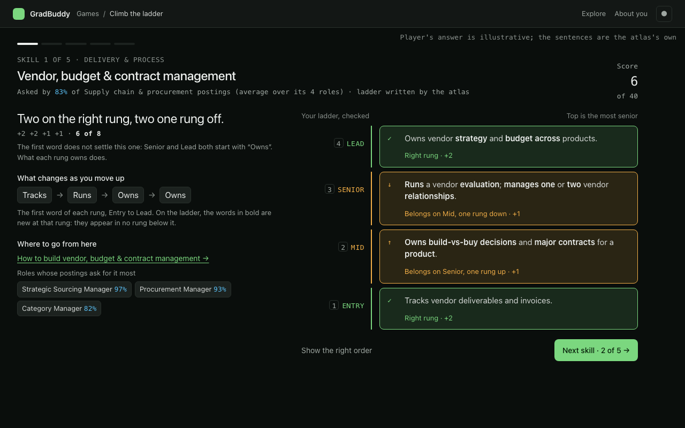
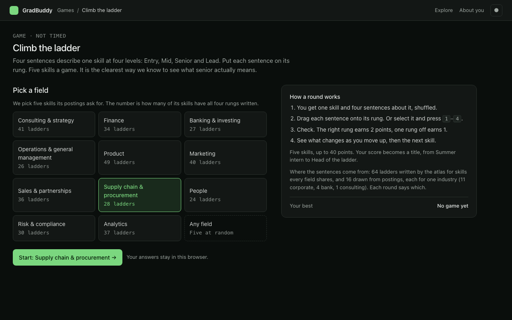
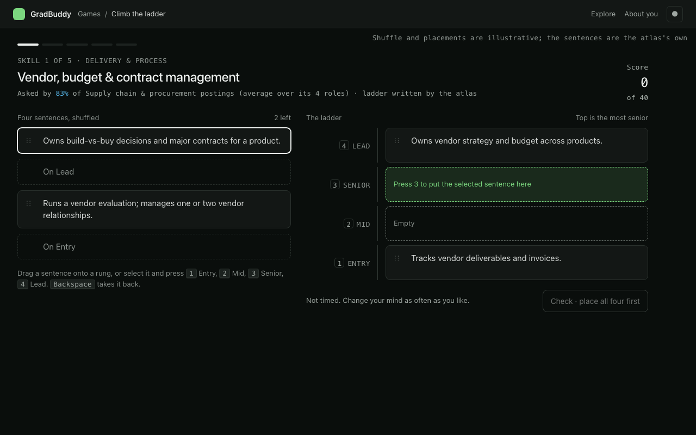
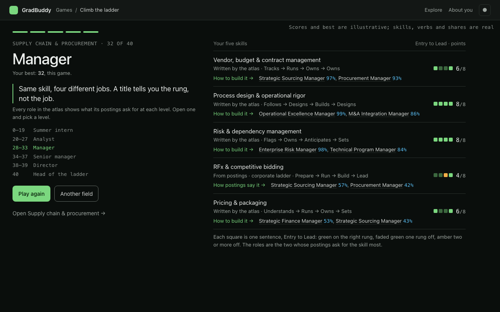
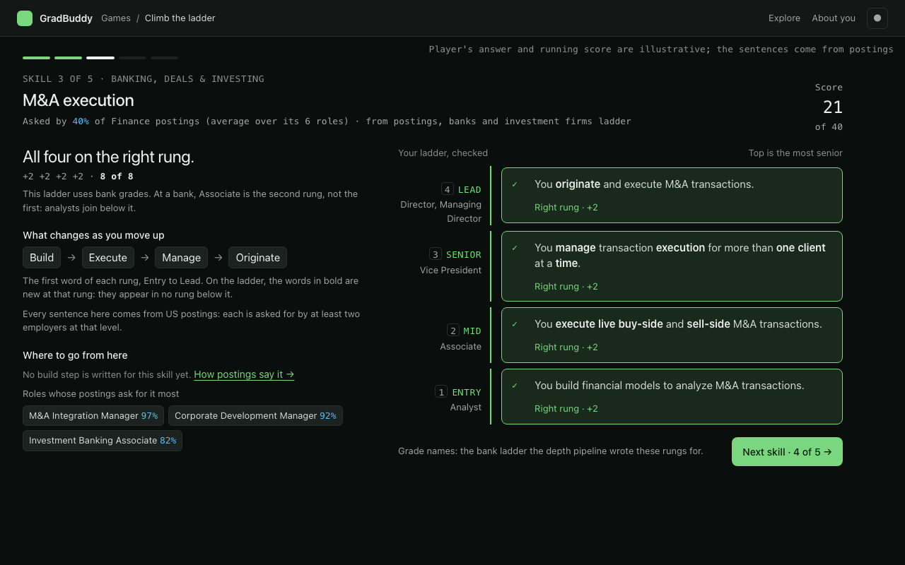

# Climb the ladder

```json
{ "slug": "climb-the-ladder", "title": "Climb the ladder", "tagline": "What senior actually means", "cover": "img/games/climb-the-ladder.png", "status": "soon" }
```

(The entry already in `web/data/games.json` has this shape and tagline; leave it as it is until the game ships, then set
`status` to `"live"`.)



## Pitch

You get one skill and four sentences that describe it at four levels: Entry, Mid, Senior and Lead. They are shuffled.
Put each one on its rung, then check. Right rungs turn green. Wrong ones turn amber and say where they belong. A
line then shows what changes as you climb. Five skills make a game. At the end your score becomes a title, and every
skill links to how to build it and to the roles that ask for it most.

It answers a question students rarely see answered in writing: what does "senior" actually mean? Not "more years". It
means a different job: one feature, then a product area, then several teams, then the company.

## Why it's fun

- One verb (put it on a rung) and one rule (the higher rung does more). You learn it in one round.
- The sentences are close enough to need a second read. "Owns build-vs-buy decisions" and "Owns vendor strategy"
  both start with "Owns". You have to read what is owned.
- You lose partial points, not the round: one rung off still earns a point. A near miss feels like learning.
- Short: five skills, a few minutes (an estimate; nobody has played it yet). Not timed. You can change your mind before you check.
- A title instead of a number ("Manager"), and a personal best that stays in your browser.
- The ending makes the atlas's point (see "End screen and punchline").

## Rules

1. Pick a field, or "Any field".
2. Five skills, one at a time. For each skill: four sentences, shuffled, and an empty ladder of four rungs (Lead at
   the top, Entry at the bottom).
3. Put each sentence on a rung. Drag it there, or select it and press `1` to `4`. A rung holds one sentence. Putting
   a sentence on a full rung swaps the two.
4. "Check" turns on when all four rungs are full. After the check the round is final.
5. Points per sentence: right rung 2, one rung off 1, two or more off 0. Up to 8 per skill, 40 per game.

## A round, step by step

1. **Pick** (`mocks/01-pick.html`). Eleven field tiles. Each shows how many of its skills have a full ladder. There is
   also an "Any field" tile. Below them: "Start". Beside them: the rules in four lines, where the sentences come
   from, and your best score.
2. **Sort** (`mocks/02-sort.html`). Header: progress (five bars), the skill area as an eyebrow (text, not a colour),
   the skill name, and one fact line. The fact line gives the share of the field's postings that ask for the skill,
   in blue, and where the ladder comes from ("ladder written by the atlas", or "from postings, <industry> ladder").
   Left: the four sentences. Right: the ladder, each rung with its key (`4` Lead … `1` Entry). For a postings
   ladder, each rung also shows the industry's grade name. A placed sentence leaves a dashed "On Lead" ghost in the
   pile, so the pile does not jump.
3. **Check** (`mocks/03-checked.html`, `mocks/05-checked-bank.html`). Each sentence stays where you put it:
   - right rung: green border and tint, "Right rung · +2";
   - wrong rung: amber, with an arrow and "Belongs on Mid, one rung down · +1" (or "two rungs up · 0").
   Left: a verdict in words ("Two on the right rung, two one rung off."), the points (`+2 +2 +1 +1 · 6 of 8`), and
   **What changes as you move up** (next section). Then **Where to go from here**: "How to build <skill> →" and the
   three roles whose postings ask for the skill most, each with its share in blue. "Show the right order" moves the
   sentences to their rungs, with a short animation (none under reduced motion). "Next skill" goes on.
4. **End** (`mocks/04-end.html`) after skill 5.

## "What changes as you move up": what we can derive and what must be written

The brief asks for a line such as "scope: from one feature to the whole product line". **No such line exists in the
data.** The ladders have four sentences each and nothing else. Two things can be computed honestly from the rung
text, and v1 shows only those:

1. **The verb chain**: the first word of each rung, Entry to Lead, with "You " removed from postings ladders. Vendor
   management: `Tracks → Runs → Owns → Owns`. M&A execution (bank): `Build → Execute → Manage → Originate`. Facts
   across the 64 atlas-written ladders: the Lead rung starts with "Sets" in 25 of them. Mid and Senior start with
   the same word in 14. All four first words differ in 39. When two rungs share a word, the round says so ("The
   first word does not settle this one: Senior and Lead both start with 'Owns'."). Write it from that comparison,
   not by hand.
2. **New words per rung**: on the checked ladder, words in bold appear in no lower rung. The rule: split into words
   (`[A-Za-z][A-Za-z&-]*`), lowercase, drop a final `s`, skip a short stop list (`the a an and or of to for in on
   with you your that is are as at by it its their they them this these those be can more than`). Every word not
   seen in a lower rung is new. The Entry rung has no bold. On vendor management the Lead rung's new words are
   "strategy", "budget" and "across". On the bank M&A ladder the only new word at Lead is "originate".

**A written one-line summary per skill is a data gap.** Who can fill it:
- **The 64 atlas-written ladders** (product depth files, written by hand): the owner, or a writer the owner names. Add
  one field per skill, for example `"climb": "Scope: from one vendor's invoices to vendor strategy across products."`
  (that sentence is **illustrative**, not data), in `pipeline/depth/*.json` on a `data/` branch. The graph build then
  copies it into `graph.json`. Not in this game's build.
- **The postings ladders** (`pipeline/depth/mba_*.json`): these files are written only by `pipeline.depth_publish`
  from checked runs, never by hand (CLAUDE.md). A summary line would have to be drafted by `depth_gen` and pass its
  checks, with a new eval in `evals/run_depth.py`. That is a pipeline task for the owner to schedule. Until then
  these ladders show the computed parts only.

The game shows the written line when the field exists and otherwise leaves it out. It never makes one up.

## Scoring and rank titles

| Placement | Points |
|---|---|
| Right rung | 2 |
| One rung off | 1 |
| Two or three off | 0 |

Per skill 0–8. The possible totals are 0, 1, 2, 3, 4, 6 and 8: one swap of neighbours scores 6. Per game 0–40.

Random play (computed over all 24 orders of four sentences, five skills): median 17, 95.8% of random games score 24
or less, and 0.86% score 28 or more. The titles are set so that guessing lands on the first one:

| Score | Title |
|---|---|
| 0–19 | Summer intern |
| 20–27 | Analyst |
| 28–33 | Manager |
| 34–37 | Senior manager |
| 38–39 | Director |
| 40 | Head of the ladder |

The titles are generic grades. On purpose they do not follow one industry's ladder: at a bank "Associate" is the
second rung.

## Difficulty

There are no modes in v1. Difficulty comes from which ladders are allowed in and how the five are chosen:

- **Qualifying ladder:** all four rungs present and not empty. A ladder with three rungs never appears.
- **Near-identical rungs are excluded.** Measure word overlap (Jaccard on content words, the stop list above) between
  neighbouring rungs and exclude a ladder if any pair reaches **0.35** or more. This removes two postings ladders:
  Employee engagement & culture, corporate (0.50: "You develop action plans to improve employee engagement." next to
  "You develop engagement survey action plans for managers.") and Earned value management, corporate (0.36). None of
  the 64 atlas-written ladders passes 0.30.
- **Order within a game:** easiest first. Sort the five by the highest neighbour overlap, lowest first, so a game
  ends on its closest ladder. Optional, and cheap.
- A postings ladder is harder than an atlas-written one. Its sentences are posting language ("You bring at least
  five years of experience…" is the kind of rung the filter keeps out). Not every one rises neatly in scope. At most
  **two** postings ladders per game.

## End screen and punchline

`mocks/04-end.html`. Left: the field and score as an eyebrow, the title large ("Manager"), your best, then the
punchline:

> Same skill, four different jobs. A title tells you the rung, not the job.

Under it: "Every role in the atlas shows what its postings ask for at each level. Open one and pick a level." Then the
title table with yours marked, and three actions: "Play again" (same field, a new draw), "Another field", and "Open
<field> →" (`#/field/<group>`).

Right: the five skills. Each row shows: the name; the source ("Written by the atlas" or "From postings · corporate
ladder") and the verb chain; four squares, Entry to Lead (green right, faded green one off, amber further); points;
"How to build it →"; and the two roles that ask most, with shares in blue.

Like the 403 game's "Nobody keeps up by hand. That's the point.", the line is about what the product fixes. A job
title does not say what the work is. The atlas shows it, level by level.

## How it sends people into the atlas

- **"How to build <skill> →"** opens the skill's build steps inside the game: a drawer under the row with the steps
  as written (`skills[].build`), the same list the side panel shows. There is no route to one skill on a role screen
  today (`#/role/<id>` has no `?skill=`). See open question 2.
- When a skill has no build step (every postings-ladder skill in the pool, see below), the link reads "How postings
  say it →". It goes to the top role's screen, `#/role/<id>`.
- **Roles that ask for it most** → `#/role/<id>`, top three on the checked screen, top two on the end screen.
- **"Open <field> →"** → `#/field/<group>` on the end screen.

## Data sources

All in `web/data/`, read through `web/atlas.js`. Nothing new is generated and no data file changes.

| What | File · field | Notes |
|---|---|---|
| Atlas-written ladders | `graph.json` · `skills[].ladder` = `{associate, mid, senior, lead}` (strings) | Hand-written in `pipeline/depth/{craft,discovery_analytics,domain_credentials,gtm,leadership_delivery_tools,technical}.json`. **64 of 98** product skills have all four rungs. The other 34 have no ladder. The same 64 appear with identical text in `graph_mba.json` as shared skills. |
| Postings ladders | `graph_mba.json` · `skills[].ladder` = `{corporate|bank|consulting: {associate, mid, senior, lead}}` | Written by `pipeline.depth_publish`. A rung the postings do not support is absent. 134 MBA-only skills have one of these ladders. 80 skills have none. |
| Build steps | `skills[].build` | Atlas-written: a list of 3 strings for all 64. MBA: a list, or for 3 skills an object keyed by ladder (`valuation`, `credit_analysis`, `client_coverage`, bank only). **None of the 16 postings-ladder skills has a build step.** |
| Share in a field | `graph_mba.json` · `skills[].by_family[role]`, averaged over `groups[].families`. For the Product field: `graph.json` · `skills[].by_family` over its six families. | MBA shares are company-balanced (one employer counts for at most 5% of a role). Product shares are not. Say "of postings" for both, as the role screen does. |
| Roles that ask most | the same `by_family`, both sets. Skip the MBA `product` group's families (`product_manager`, `product_strategy`): `Atlas.index()` drops that group and the Product field opens the product set. | Link `#/role/<id>`. Labels from `ix.roles[id].label`. |
| Grade names per industry | `graph_mba.json` · `ladders.<l>.levels` (associate, mid, senior) | The lead rung groups staff, group, director, vp and cpo (`Atlas.STEP_OF`, and `RUNG_OF` in `pipeline/depth_gen.py`). `pipeline/depth_gen.py` `RUNG_NAMES` names the four rungs per ladder (bank: Analyst, Associate, Vice President, "Director, Managing Director"). That constant is not in `web/data`: copy it into the game as a constant and cite the file. |
| Skill area (eyebrow) | `clusters[skill.cluster].label` | Text only. Do not use `clusters[].color`. |
| Generic skills | `Atlas.genericSkills()` | Skills most postings of at least half the MBA roles ask for. Approximated from `by_family`: collaboration, communication, cross_functional, execution, influence, ownership, problem_solving, stakeholder_mgmt. Left out of a field's draw, because they say nothing about the field. |

### Counts (by script, on the data files of 2026-10-11 (product) and 2026-10-14 (MBA))

Postings ladders with all four rungs, per industry ladder:

| Industry ladder | Ladders shown | Rung counts (2 / 3 / 4) | All four rungs | After the near-identical filter |
|---|---|---|---|---|
| Corporate | 116 | 55 / 48 / 13 | 13 | 11 |
| Banks and investment firms | 59 | 35 / 20 / 4 | 4 | 4 |
| Consulting firms | 21 | 17 / 3 / 1 | 1 | 1 |
| **Total** | 196 | | **18 ladders, 16 skills** | **16 ladders, 14 skills** |

The 16 that qualify: corporate: operating_cadence, financial_statements, debt_capital_structure, campaign_management,
warehouse_fulfillment, rfx_bid_mgmt, employee_relations, succession_workforce_planning, comp_design,
regulator_exams, data_governance. Bank: special_projects, debt_capital_structure, ma_execution, regulator_exams.
Consulting: client_engagement.

Qualifying ladders per field. A ladder counts when the field's postings ask for the skill at an average of 10% or
more over its roles, and the skill is not generic. These are the numbers on the pick tiles:

| Field | Atlas-written | From postings | Tile |
|---|---|---|---|
| Consulting & strategy | 38 | 3 (client_engagement consulting, operating_cadence corporate, special_projects bank) | 41 |
| Finance | 28 | 6 (operating_cadence, financial_statements, debt_capital_structure corporate and bank, special_projects, ma_execution) | 34 |
| Banking & investing | 23 | 4 (financial_statements, debt_capital_structure ×2, ma_execution) | 27 |
| Operations & general management | 26 | 0 | 26 |
| Product | 49 | 0 | 49 |
| Marketing | 39 | 1 (campaign_management) | 40 |
| Sales & partnerships | 35 | 1 (operating_cadence) | 36 |
| Supply chain & procurement | 27 | 1 (rfx_bid_mgmt) | 28 |
| People | 21 | 3 (employee_relations, succession_workforce_planning, comp_design) | 24 |
| Risk & compliance | 27 | 3 (regulator_exams ×2, data_governance) | 30 |
| Analytics | 36 | 1 (data_governance) | 37 |

Every field has at least 21 candidates, so a draw of five always fills. The generic list above is an approximation
(see the table). The builder computes the tiles at load with `Atlas.genericSkills()`, and the numbers may move by one
or two.

### Choices made

- **Both sources, labelled.** The atlas-written ladders carry the game: 64 skills, clean scope steps, and shared
  vocabulary that every field asks for (vendor management is asked by 83% of Supply chain & procurement postings,
  averaged over its four roles). The postings ladders are the atlas's own evidence and are labelled by industry:
  "From postings · Banks and investment firms ladder", with the bank grade names on the rungs. At most two per game.
- **Consulting.** The consulting ladder is on hold for **build steps** only: `data/raw/build_sources.json` ·
  `ladders_on_hold.consulting` = "no source agreed for consulting skills (owner, 2026-10-13)…". Its rungs are
  published. The one qualifying consulting ladder (client_engagement) is in the pool, labelled "Consulting firms
  ladder", and has no build step. See open question 1.
- **One sentence on two ladders.** "You negotiate credit facility terms." is the **Lead** rung of
  debt_capital_structure on the bank ladder and the **Senior** rung on the corporate ladder. It is the only repeated
  statement in the MBA depth. Never draw both ladders of one skill in a game. It would also make a good
  "same words, different rung" note later.
- **Voice.** Atlas-written rungs have no subject ("Owns the risk register…"). Postings rungs start with "You". Each
  ladder is shown as written, with no rewording.

### atlas.js functions to reuse

- `Atlas.index()` for the fields (`groups`), role labels (`roles[id].label`), `M.skills`, `M.ladders` and `M.clusters`.
- `Atlas.product()` for the product skills (`G.skills`, `G.families`, `G.clusters`). Load it at game start, because
  the atlas-written ladders live there.
- `Atlas.genericSkills()` for the exclusion set.
- `Atlas.STEPS` (`entry, mid, senior, lead`), for rung order and labels. Map them to data keys
  `associate, mid, senior, lead`, as `app.js` does (`LADDER_KEYS`).
- No new data file is read. Everything comes through the calls above, which are cached.
- Do **not** call `Atlas.role()`. It loads a role's postings, and this game needs none.

## Data gaps and who fills them

| Gap | Effect in the game | Who |
|---|---|---|
| No written "what changes" line for any skill | Computed verb chain and bold new words only | Owner, for the 64 atlas-written ladders (`data/` branch). Pipeline (`depth_gen` + eval) for postings ladders. |
| No build step for any of the 16 postings-ladder skills | "How postings say it →" to the top role | Pipeline: `pipeline.build_steps`. Consulting waits for an agreed source. |
| Only 18 postings ladders have four rungs (13 / 4 / 1) | At most two per game, none in Operations or Product | A new depth run, if the owner wants more |
| 34 product skills have no ladder | Never drawn | Owner (hand-written depth files) |
| Found while reading `web/app.js` `skillCard`: it reads `s.ladder[k]` flat, so an MBA skill with an industry-keyed ladder shows four empty rungs on the role screen | Not this game's problem, but the role links send players to that panel | Flag to the owner. A separate `fix/` branch. Not in this build. |

## Edge cases

- **Data fails to load:** the app's `fail()` page. The game does not start half-built.
- **Field with fewer than 5 qualifying ladders after exclusions:** not possible today (minimum 21). The code fills from
  the other fields' pool so the game always has five, and says "Two skills from other fields" on the sort header.
- **The same skill twice in one game** (bank and corporate ladders of one skill): blocked when drawing.
- **The shuffle leaves the sentences in their right order:** reshuffle until at least two are out of place.
- **Two rungs with the same text:** excluded by the overlap filter, which sees it as overlap 1.0.
- **A sentence dropped on a full rung:** swap. Dropped outside a rung: it returns to the pile.
- **Check before all four are placed:** the button stays disabled and its label says why ("place all four first").
- **Leaving mid-game** (route change): the game is lost. No resume in v1. The best score is kept.
- **Product skill share in an MBA field, or the reverse:** the shares come from different sets (see the data table).
  The fact line says "of <field> postings" and nothing more.
- **A role link to an MBA role in the hidden `product` group:** never offered (skipped in the data source).
- **Ties for "roles that ask most":** order by share, then by open postings (`nOpen`).
- **Light theme:** the tokens handle it. The mocks are dark only because the brief asks for dark.

## Keyboard and accessibility

- Every sentence is a `<button>` in tab order (pile first, then the rungs top to bottom). `Enter` or `Space`
  selects it (`aria-pressed="true"`). Then `1`–`4` puts it on Entry–Lead. `Backspace` or `Delete` sends a placed
  sentence back to the pile. `Escape` clears the selection. Arrow keys move between sentences.
- Pressing `1`–`4` with nothing selected places the first sentence still in the pile. That keeps a keyboard-only
  round to four key presses plus Enter.
- `Enter` on the "Check" button checks. After a check, focus moves to the verdict line, then "Next skill".
- Drag and drop uses pointer events (`pointerdown`, `pointermove`, `pointerup`) with a visible drop target
  (`.cl-slot.over`). It is an extra; the keyboard path does everything.
- Results are said in words as well as colour: "Right rung · +2", "Belongs on Mid, one rung down · +1". The arrows
  ↑ ↓ repeat the direction. An `aria-live="polite"` region reads the verdict and the points.
- Each rung has an `aria-label`: "Rung 3, Senior, Vice President, holds: <sentence>" or "empty".
- 13px is the smallest text (token floor). The focus ring is `--ring`. Reduced motion turns off the "Show the right
  order" animation.

## Persistence

`localStorage` only, every read and write in `try/catch` (same pattern as `store` in `app.js`):

- `game.climb-the-ladder.best` → `{ score, rank, field, date }`, the best game.
- `game.climb-the-ladder.last-field` → the last field picked, to preselect it.

No game state is saved mid-round. Nothing leaves the browser.

## Out of scope

- A timer, lives or streaks. The game is not timed.
- A shared or global leaderboard. Personal best only.
- Phone layout (desktop only, owner's decision 2026-10-13).
- Writing the "what changes" lines, or any change to `pipeline/`, `web/data/`, `web/match.js`, the taxonomy or the
  evals.
- A `?skill=` deep link on role screens (open question 2).
- Fixing the empty industry ladders in `skillCard` (flagged above).
- Mixing ladders from industries the player did not pick into a per-industry mode (open question 3).

## Open questions for the owner

**1. Consulting's one ladder (client_engagement): in or out?** Its rungs are published. Only its build steps are on hold.
- **A. In, labelled "Consulting firms ladder", no build step (recommended).** It is the only consulting ladder with
  four rungs. It is the one Consulting & strategy players see, and it says nothing a source has to back.
- B. Out until the consulting hold is lifted. Simpler to explain, but Consulting & strategy then has only 2 postings
  ladders.
- C. In, with a notice that consulting content is on hold. Honest, but it adds noise for a detail players will not
  miss.

**2. Where does "How to build <skill> →" go?**
- **A. A drawer in the game with the steps as written (recommended).** No change outside the game. The steps are the
  same text the side panel shows.
- B. Add `?skill=<id>` to `#/role/<id>` in `app.js` so the role screen opens with that skill's card. One extra line
  in the router. It touches the role screen, which the build prompt otherwise leaves alone.
- C. Link to the top role only and let the player find the skill. No code, but the player has to look for it.

**3. Industry ladders: mixed in, or a mode?**
- **A. Mixed in: at most two per game, labelled per round (recommended).** Every field gets the clean ladders and a
  taste of the posting language.
- B. A "Postings" mode with industry chips (Corporate / Bank / Consulting). It shows the industry differences
  better, but bank has 4 qualifying ladders and consulting 1, so a five-skill game cannot be filled.
- C. Atlas-written only in v1. The cleanest play, but it loses the bank grades lesson ("Associate is the second
  rung").

**4. Rank titles.**
- **A. Generic grades, Summer intern to Head of the ladder, as in the table (recommended).**
- B. The chosen industry's own grades (at a bank: Analyst, Associate, VP…). On theme, but "Associate" would rank
  above "Analyst" for bank players and below "Manager" for others.
- C. Playful titles ("Reads the job description", "Knows the org chart"). Funnier, but they leave the atlas's
  language.

## Effort estimate

About **1.5 to 2 days** for one Claude Code thread:
- data and draw logic: pool, filter, field shares, verb chain, new words: half a day;
- screens, the drag-and-drop and keyboard paths, and the styles (start from `mocks/climb.css`): a day;
- accessibility pass, edge cases, both themes, checks against the mocks: half a day.

## Mocks

| Screen | File |
|---|---|
| Pick a field | [`mocks/01-pick.html`](mocks/01-pick.html) |
| Sort (mid-round) | [`mocks/02-sort.html`](mocks/02-sort.html) |
| Checked, atlas-written ladder | [`mocks/03-checked.html`](mocks/03-checked.html) (also `cover.png`) |
| End of the game | [`mocks/04-end.html`](mocks/04-end.html) |
| Checked, bank postings ladder | [`mocks/05-checked-bank.html`](mocks/05-checked-bank.html) |

`mocks/climb.css` is the proposed style section (tokens only).

The data in the mocks is real and quoted exactly: rung sentences, verb chains, skill names, shares and role names.
Player moves, scores and the best score are **illustrative**, and each screen labels them so.






