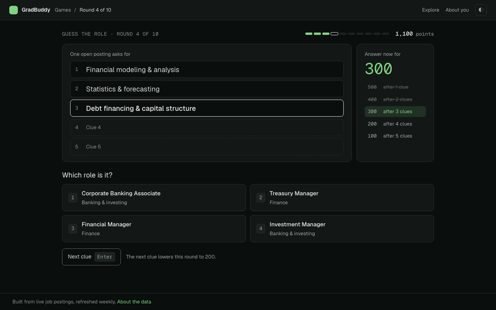
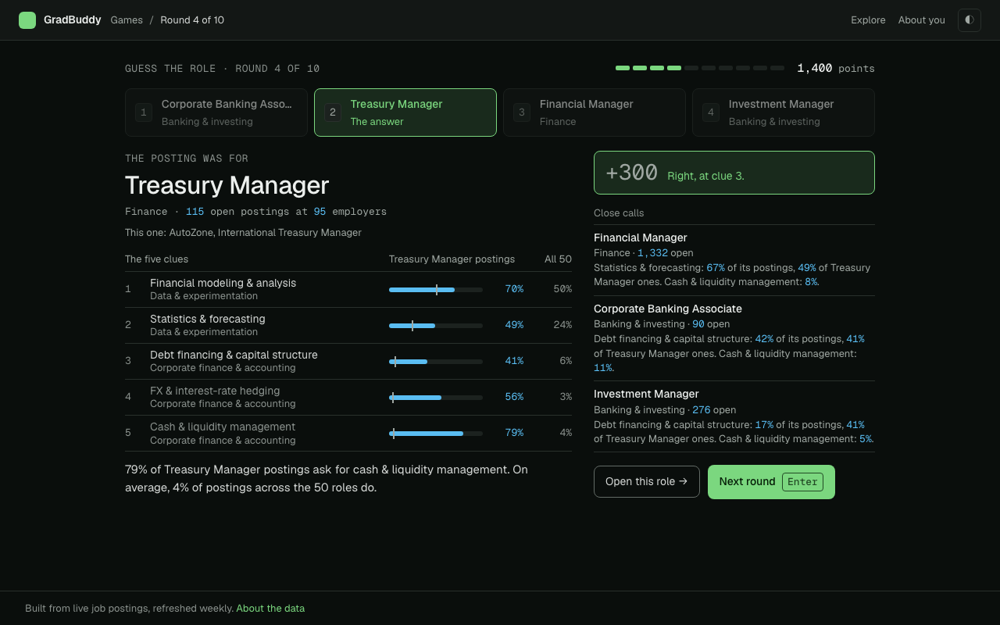
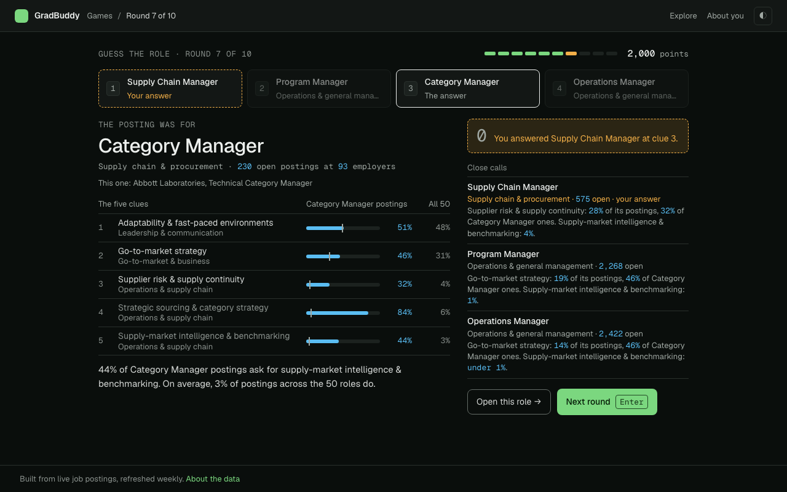
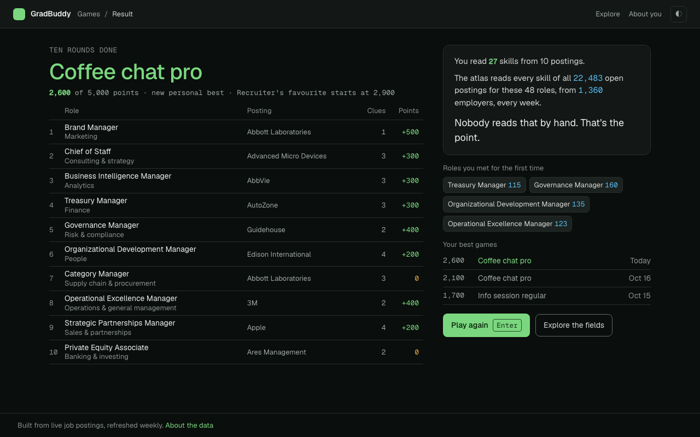
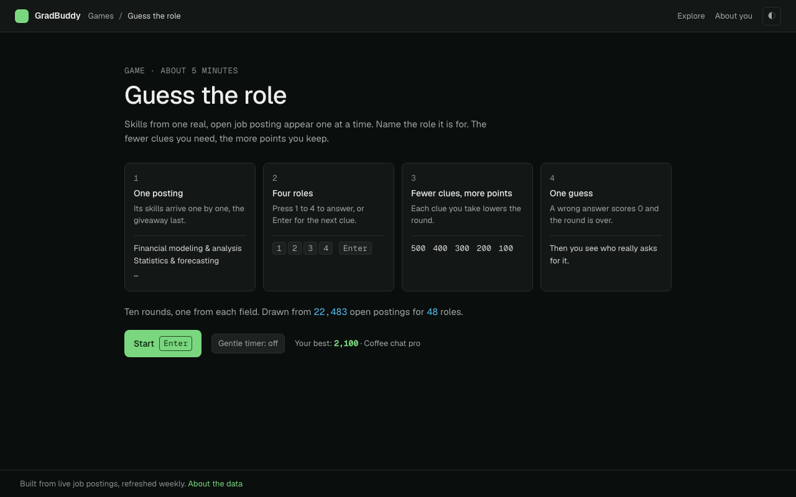

# Guess the role

> Rebuilt in v12 (2026-10-20, PLAN.md "The games, second pass", GTR1 and GTR2): five rounds from five fields, the
> player's own first; three clues, the first already distinctive, the giveaway last; 300 / 200 / 100 points by the
> clue, a second guess for half, 1,500 a game; no rank titles. The reveal leads with the giveaway. The sections below
> describe the first build (ten rounds, five clues, one guess) and still hold for the pool, the distractors and the
> giveaway; the clue rule as built is under "The three clues" and the counts are the eval's (`evals/games_guess_the_role.mjs`).

```json
{ "slug": "guess-the-role", "title": "Guess the role", "tagline": "Name the job from its skills", "cover": "img/games/guess-the-role.png", "status": "soon" }
```

This is the design package for one game in the role atlas: the spec, the data rules, and high-fidelity mocks. The build
prompt for a fresh Claude Code thread is in [PROMPT.md](PROMPT.md). The tagline matches the entry already in
`web/data/games.json`.



## Pitch

You see skills from one real, open job posting, one at a time: *Financial modeling & analysis… Statistics &
forecasting… Debt financing & capital structure…* Four roles to choose from. Answer now for 300 points, or take
another clue and play for 200. The reveal tells you it was a Treasury Manager posting at AutoZone, that 79% of
Treasury Manager postings ask for cash & liquidity management (against 4% across the 50 roles), and which of the other
three came close and why. Ten rounds, one from each field, about five minutes. You finish with a rank title and a link
into every role you met.

## Why it's fun

It follows the pattern that makes infisical.com/403 work, translated to careers:

| infisical/403 | Guess the role |
|---|---|
| One verb, one rule, taught by four example tiles | One verb (name the role) and one rule (fewer clues, more points), taught by four tiles on the start screen |
| Short rounds that speed up | Ten short rounds. They do not speed up: the pressure comes from the falling points, not a clock. A gentle timer is optional |
| Permanent stakes (blown slots stay blown) | One guess per round. A wrong answer scores 0 and the round is over; its pip stays amber for the rest of the game |
| A rank title, not a number | "Career fair tourist" up to "Walking job board" |
| A personal leaderboard | Your best five games, in this browser only |
| An ending that makes the product's point | "You read 27 skills from 10 postings. The atlas reads every skill of all 22,478 open postings… Nobody reads that by hand. That's the point." |

What makes it more than trivia: every clue is a real posting's skill, and every reveal has a real number behind it.
The "close calls" teach what actually separates neighbouring roles (Treasury Manager against Financial Manager is cash
& liquidity management, 79% against 8%). That is the atlas's skill grid, learned by playing.

## Rules

As built in v12:

1. A game is 5 rounds, one from each of five fields: the profile's fields first, in its order, then the rest shuffled.
2. Each round shows skills from one open posting, one at a time, up to three.
3. Four roles to choose from. Press 1–4 (or click) to answer; press Enter (or click "Next clue") to see another skill.
4. Answer after 1 clue: 300 points. After 2: 200. After 3: 100.
5. Two guesses per round. A wrong first guess strikes that role and leaves one more guess for half the points; a
   second wrong guess scores 0 and shows the answer.
6. After every round, the reveal. Enter goes to the next round.
7. At the end: your score out of 1,500, the change since last time, and the roles you met.

The first build's rules (ten rounds, five clues, one guess, 500 to 100 points, 5,000 a game, rank titles) are what
the mocks and the sections below describe.

### The three clues (v12)

The candidates are the posting's typical skills (share at least 25%) but the giveaway, those not red herrings
(`RED_HERRING`, relaxed on a second pass), sorted by lift. Clue 1 is the first of the more distinctive half of that
list (`rest[min(floor(n / 2), n - 2)]`), so it is never the skill every role asks for; clue 2 is the last (the most
distinctive but the giveaway); clue 3 is the giveaway. A posting needs two candidates to be playable. On the data of
2026-10-19: 22,367 open postings, 20,313 playable (90.8%), 1,116 with fewer than 8 eligible skills, the relaxed rule
needed for 364.

## A round, step by step

| Step | What the player sees | What the code does |
|---|---|---|
| 0 | "Round 4 of 10", the pips, the score so far, a loading line if the role file is not ready | Picks the round's role (see Sampling), loads its role file (usually prefetched during the previous round), picks a posting, its three distractors and its five clues |
| 1 | Clue 1 appears in the board. Clues 2–5 are dashed placeholders. The ladder shows "Answer now for 500" | Announces the clue in an `aria-live` region |
| 2 | The player presses Enter: clue 2 appears, highlighted as the newest; 500 is struck through; "Answer now for 400" | One more clue; points fall by 100 |
| 3 | The player presses 2 (Treasury Manager) at clue 3 | Locks the answer; no further input until the reveal renders |
| 4 | The reveal: the four options with "The answer" and "Your answer" marked; the role name, field, open postings and employers; the posting's company and title; all five clues with the share of the role's postings that ask for each, against the average across the 50 roles; one sentence on the giveaway clue; the three close calls; "Open this role →" and "Next round" | Writes the round to the game state; prefetches the next role file |
| 5 | Enter: the next round | |

Mocks of the clue board and the reveal, right and wrong:





What the player never sees before the reveal: the posting's title and company. A title like "International Treasury
Manager" gives the answer away. Skill areas (the text labels such as "Corporate finance & accounting") are also held
back until the reveal, because the area of the last clues usually names the field.

## How the game is built from the data

All numbers in this section come from the repo data (`web/data/graph_mba.json` generated 2026-10-14 and the role
files under `web/data/graph_mba/`), computed with `web/atlas.js` loaded in node exactly as the evals do. The scripts
are scratch work and not in the tree; the method below is complete enough to reproduce every number.

### Terms

- **share(r, s)**: `skills[s].by_family[r]` in `graph_mba.json`, the company-balanced share of role r's postings that
  ask for skill s (closed postings included, as everywhere in the atlas; see `meta.shares.note`).
- **average(s)**: `Atlas.index().baseline[s]`, the mean of share(r, s) over the 50 MBA roles in `M.families`. This is
  the same "elsewhere" the atlas uses for its defining mark. The reveal labels it "All 50".
- **lift(r, s)** = share(r, s) / max(average(s), 0.01): how much more role r asks for s than the average role.
- **Eligible skill**: not in the `credentials` cluster, id not starting with `yoe_`, and not one of the 8 generic
  skills that `Atlas.genericSkills()` returns (Written & verbal communication, Collaboration & teamwork, Execution &
  delivery, Stakeholder management, Structured problem solving, Ownership & bias for action, Cross-functional
  leadership, Influence without authority). That leaves 242 of the 278 skills. Generic skills make no clue: they are
  asked by most postings of at least half the roles, so they tell you nothing.

### The pool: which roles and postings

- **Roles**: the 48 MBA roles in `Atlas.index().groups`, 10 fields (the "Product" group is skipped by `index()`, as in
  the app). The 6 product roles in `graph.json` are out of the first version (open question 1).
- **Postings**: open only (`job.open`), with at least 8 eligible skills. Of 22,478 open postings across the 48 roles,
  1,142 have fewer than 8 eligible skills; the median open posting has 19.
- **Playable postings**: those for which the clue rule below finds five clean clues. 18,999 of the 22,478 open
  postings are playable (85%). Every role has some; the fewest is Venture Capital Associate with 14 playable of 19
  open.

### Sampling: how the 10 rounds are drawn

- One role from each of the 10 fields, in a random order. Within a field, every role is equally likely, not weighted
  by postings. This is how the game surfaces roles students don't know: Treasury Manager is 1 of 6 Finance roles, so
  it comes up in 1 game in 6 (17%); weighted by postings it would be 115 of 2,283 Finance postings (5%). Governance
  Manager is 1 in 3 against 160 of 1,101 (15%).
- Prefer roles the player has not met: keep the ids of roles seen in this browser (see Persistence); draw from the
  unseen roles of a field first. The largest field (Banking & investing) has 9 roles, so a regular player meets every
  role within 9 games.
- Within the role, one playable posting uniformly at random. Never two postings from the same company in one game,
  and never the same company and title twice in a row across games (BNY, for example, has several near-identical
  Treasury postings).

### The three distractors: fair but not trivial

Each role has a skill profile: its share vector over the 242 eligible skills. Similarity is the cosine between two
profiles. The distractors for role r:

1. Leave out every role with similarity above 0.90. Twelve pairs of roles are that alike, and telling them apart
   from five skills is luck, not knowledge: FP&A Manager and Financial Manager (0.98), Business Analytics Manager and
   Business Intelligence Manager (0.96), Procurement Manager and Strategic Sourcing Manager (0.96), Strategic Sourcing
   Manager and Category Manager (0.95), Marketing Manager and Growth Manager (0.94), Procurement Manager and Category
   Manager (0.94), Strategy Manager and Business Operations Manager (0.93), Sales Manager and Business Development
   Manager (0.92), FP&A Manager and Strategic Finance Manager (0.91), Transformation Manager and Digital
   Transformation Manager (0.91), Strategic Finance Manager and Financial Manager (0.90), Investment Manager and
   Private Equity Associate (0.90).
2. **Pattern 2 + 2**: the nearest role from the same field, plus the two nearest roles of one other field (the field
   whose two nearest roles have the highest mean similarity). The four options are then two pairs of fields, so the
   field labels on the options never single out the answer. A pattern like 2 + 1 + 1 would: the answer would always
   be in the pair.
3. **Pattern 1 + 1 + 1 + 1** when the field has no other role under the cap: the nearest role from each of three
   other fields. Only Business Analytics Manager and Business Intelligence Manager need it (Analytics has two roles,
   and they are 0.96 alike).

Result: 46 roles use 2 + 2, 2 use 1 + 1 + 1 + 1, and distractor similarity ranges from 0.53 to 0.90. Treasury
Manager's options are Financial Manager (0.77), Corporate Banking Associate (0.75) and Investment Manager (0.72).
Distractors depend only on the index, so compute them once per session.

### The five clues: least distinctive first, the giveaway last

For a posting of role r with distractors D, using the posting's eligible skills:

- **disc(s)** = ln(max(share(r, s), 0.005)) − max over d in D of ln(max(share(d, s), 0.005)): how much better s points
  to r than to the strongest distractor.
- **Clue 5, the giveaway**: the skill with share(r, s) ≥ 0.25 and disc(s) > 0 that has the highest disc(s).
- **Clues 1–4**: the other skills with share(r, s) ≥ 0.25 (typical of the role, not a quirk of the posting) and
  disc(s) ≥ −ln(1.5) (no red herring: the role asks for it at least two thirds as often as any distractor). Sort them
  by lift, lowest first, and take the first, the one at a third, the one at two thirds and the last. Clues therefore
  climb from "every option asks for this" to "this is nearly the answer".
- If fewer than four skills qualify, retry with −ln(2). If that fails too, the posting is not playable; pick another.
  The relaxed rule is needed for 1,403 of the 18,999 playable postings.

**Why least distinctive first.** The points reward guessing early, so early clues must be hard, or 500 points is
free. We measured it with a model player that knows every share and picks the option with the highest sum of
ln(share) over the clues seen (a ceiling on a well-informed human, not a forecast of one), over all 18,999 playable
postings:

| Clues seen | 1 | 2 | 3 | 4 | 5 |
|---|---|---|---|---|---|
| Least distinctive first (chosen) | 15% | 39% | 67% | 85% | 95% |
| Same clues, most distinctive first | 100% | 98% | 97% | 96% | 95% |

With the giveaway first, the model is right at clue 1 every time: there is no game. Least first gives a real
trade-off between points and certainty, and the round still ends with a clue that settles it, so the reveal feels
earned, not arbitrary.

### Scoring and rank titles

500 / 400 / 300 / 200 / 100 by the clue at which you answer; 0 for a wrong answer. A game is out of 5,000.

The thresholds are set against the model player above. If it always answered at the same clue, its expected game
would be 760 (always at clue 1), 1,564 (clue 2), 2,001 (clue 3), 1,695 (clue 4) or 948 (clue 5). So "Coffee chat
pro" starts at 2,000, about what a player who knows every share earns by always answering at clue 3; you beat it by
knowing when to answer early.

| Score | Rank title |
|---|---|
| 0–999 | Career fair tourist |
| 1,000–1,999 | Info session regular |
| 2,000–2,899 | Coffee chat pro |
| 2,900–3,799 | Recruiter's favourite |
| 3,800–5,000 | Walking job board |

The thresholds above 2,000 are a design choice (illustrative) to tune after the first playtests; the model player says
nothing about how humans score.

### Difficulty

- Built in: early clues are hard by construction (above), and the distractor cap removes the unfair lookalikes.
- Natural spread: some roles are easy (Category Manager's giveaway, supply-market intelligence & benchmarking, is in
  44% of its postings and at most 4% of its distractors'), others are not (Chief of Staff's distractors are Business
  Operations Manager at 0.89 and two Operations roles).
- No difficulty setting in the first version. If playtests say it is too hard, lower the cap to 0.85 or drop the
  first clue (start at clue 2 for 500); both are one-constant changes.

## The reveal

Shown after every round (mocks 03 and 05):

- **The options**, the answer outlined, your answer marked: green fill if it was right, an amber dashed outline if it
  was wrong. The words "The answer" and "Your answer" carry the meaning too, not only the colour.
- **The role**: name, field, `n_open` open postings at `n_companies` employers (blue numbers, from
  `M.roles[id]`).
- **This posting**: company and title (titles carry HTML entities in the data, e.g. `&amp;`; decode before
  escaping).
- **The five clues**, each with its skill area (now shown), a blue bar for share(r, s) and a tick for average(s), the
  share and the average as numbers. Clues you did not see are dimmer.
- **The fact sentence**, about the giveaway clue: "79% of Treasury Manager postings ask for cash & liquidity
  management. On average, 4% of postings across the 50 roles do." The brief's example works the same way: 95% of FP&A
  Manager postings ask for financial modeling & analysis (`by_family.fpa` = 0.9452).
- **Close calls**, one line per distractor, with its field and open postings and a link to `#/role/<id>`: the clue
  where it came closest to the answer (highest share(d, s) / share(r, s) among clues with lift ≥ 1.5, the giveaway
  excluded), and its share of the giveaway clue. Treasury Manager against Corporate Banking Associate: "Debt
  financing & capital structure: 42% of its postings, 41% of Treasury Manager ones. Cash & liquidity management: 11%."
  That line is why clue 3 alone does not settle it.
- **Small roles**: for the five roles the index marks `small` (fewer than 60 postings: Venture Capital Associate, Real
  Estate Acquisitions Associate, M&A Integration Manager, Real Estate Development Manager, Digital Transformation
  Manager), add "Based on N postings" under the role line, as the atlas does elsewhere.
- **Actions**: "Open this role →" (`#/role/<id>`), "Next round" (Enter).

## End screen and punchline



- The rank title, large, in green (it is yours); the score out of 5,000; "new personal best" when it is one; the
  next title and its threshold.
- The ten rounds: role (linked to `#/role/<id>`), field, the posting's company, the clue you answered at, the points
  (green, or amber 0).
- **The punchline**, in the spirit of "Nobody keeps up by hand. That's the point.":

  > You read 27 skills from 10 postings.
  > The atlas reads every skill of all 22,478 open postings for these 48 roles, from 1,360 employers, every week.
  > **Nobody reads that by hand. That's the point.**

  27 is the player's own count (the clues they saw, summed over the rounds). 22,478 is the open postings in the pool
  (from the index). 1,360 is the distinct companies among them, computed here from the role files; how the game gets
  it is open question 4. "Every week" matches the
  site footer ("refreshed weekly").
- **Roles you met for the first time**, as tags linking to `#/role/<id>` with their open postings.
- **Your best games**, the personal leaderboard (top five, this browser only).
- "Play again" (Enter) and "Explore the fields" (`#/explore`).

In the mock, the player's answers, the score of 2,600, the personal bests (2,100, 1,700) and the "first time" roles
are illustrative. Every posting (company and title), role, field, share and count is real.



The start screen teaches the game with four tiles, as infisical does with its four example secrets: one posting,
four roles (1–4, Enter), fewer clues more points (500 400 300 200 100), one guess. Then the pool ("Drawn from 22,478
open postings for 48 roles", computed), Start (Enter), the optional timer and your best score.

## How it sends people into the atlas

- "Open this role →" on every reveal: `#/role/<id>`.
- Every close call links to its role: `#/role/<id>`. These are the roles students confuse with the answer, so the
  link is the natural next question ("so what does a Corporate Banking Associate do?").
- The end screen links every round's role, the new roles, and "Explore the fields" (`#/explore`). The field name on
  the reveal can link to `#/field/<group>`.
- The links use the existing routes; the game adds no new screens to the atlas beyond `#/play/guess-the-role`.

## Data sources

| What | File and field | How |
|---|---|---|
| Fields and their roles | `graph_mba.json` → `groups[]` (`id`, `label`, `families`) | `Atlas.index().groups`, skipping the `product` entry (its `roles` is filled only after `Atlas.product()` loads) |
| Role label, field, open postings, employers, role file, small | `graph_mba.json` → `roles[id]` (`label`, `group`, `n_open`, `n_companies`, `file`, `small`) | Read from `Atlas.index().M.roles[id]`, **not** `ix.roles[id]`: see the `pmm` edge case |
| Skill names, areas, shares | `graph_mba.json` → `skills[]` (`id`, `name`, `cluster`, `by_family`), `clusters[id].label` | `ix.skillById[id]`, `ix.M.clusters` |
| Average across the 50 roles | computed from `skills[].by_family` over `families` | `ix.baseline[id]` |
| Generic skills | computed | `await Atlas.genericSkills()` |
| A role's postings | `graph_mba/<role>.json` → `jobs[]` (`id`, `company`, `title`, `location`, `level`, `open`, `skills` as indices into `skill_ids`, `w`) | `await Atlas.role(id)` → `R.jobs`, decoded (skills become ids) and cached by `fetchJson` |
| Pool size on the start and end screens | `graph_mba.json` → `roles[id].n_open` | Sum over the 48 roles: 22,478 (the same count as the open postings in the role files). The employers figure in the end-screen mock (1,360 distinct companies among those postings) needs every role file to compute; see open question 4 |

Do not compute anything from the product set: the first version uses no data from `web/data/graph.json`.

**Loading lazily.** `graph_mba.json` is 1.83 MB and is usually loaded already by the time a player reaches the game.
The role files range from 20 KB (Venture Capital Associate) to 2.65 MB (Operations Manager), 26.3 MB for all 48, so
never load them all: load the first round's file on Start, and prefetch round n+1's file while round n is played
(`Atlas.role(nextId)` without awaiting). Show "Loading the next posting…" only if the player is faster than the
network. `graph.json` (9.37 MB) is never loaded by the game. Everything the clue and distractor rules need except the
posting itself is in the index, so distractors are computed once from the index and a role file is needed only to
pick the posting.

**Reuse, do not re-implement**: `Atlas.index`, `Atlas.role`, `Atlas.genericSkills`, `Atlas.fetchJson`, `ix.baseline`,
`ix.skillById`. `Atlas.TIER.common` is 0.25, the share floor used above. Do not change `atlas.js`, `match.js`, the
taxonomy or any data file.

## Edge cases

- **The `pmm` id is shared**: *(Fixed 2026-10-18: product families are now `product.<family>` in `ix.roles`, so `ix.roles.pmm` is always the MBA role; see PLAN.md v10.)* the MBA role Product Marketing Manager (Marketing field) and the product family
  Product Marketing Manager both use `pmm`. When `Atlas.product()` has run (the Explore screen starts it in the
  background), `ix.roles.pmm` is overwritten by the product version. The game must read role metadata from
  `ix.M.roles` and postings via `ix.M.roles.pmm.file`, and must never call `Atlas.product()`. "Open this role →" for
  `pmm` opens whichever version the app has loaded; that is an existing app behaviour, flagged for the owner, not
  fixed by the game.
- **The title gives it away**: never render the title or company before the reveal, including in `document.title`
  and the crumbs.
- **HTML entities in titles** (`&amp;` occurs in the data): decode, then escape.
- **A role with no playable posting left** after the same-company rule: take another role from the same field.
- **A role file fails to load**: skip to another role of the same field; if two fail in a row, show the app's
  "Something did not load" message with a link back to `#/`.
- **Ties**: for the giveaway, break disc(s) ties by share(r, s); for clue order, by skill id, so a seed reproduces a
  game.
- **Weekly refresh**: the pool changes when the data does. Personal bests stay comparable (the scale does not change);
  store `meta.generated` with each best for reference.
- **Double input**: ignore keys between an answer and the rendered reveal; ignore Enter on the last clue (there is no
  clue 6; the player must answer).
- **Leaving mid-game**: the game state is in memory; going back to `#/play/guess-the-role` starts over. No "resume"
  in the first version.
- **Desktop only**, as the rest of the site; the layout targets 1280 wide and works down to about 1024.

## Keyboard and accessibility

- 1–4 answer; Enter takes the next clue during a round, goes to the next round on the reveal, and starts or replays
  on the start and end screens. Clicks do the same. Keys are listened for on the game's container while the route is
  active and removed when it is left; they never fire while focus is in a text field.
- The options are real `<button>`s with `aria-keyshortcuts="1"` and so on; each new clue is announced in a polite
  live region ("Clue 3 of 5: Debt financing & capital structure. Answer now for 300 points.").
- After an answer, focus moves to the reveal's heading; after "Next round", to the clue board.
- Colour never carries meaning alone: right and wrong also read "The answer" and "Your answer", +300 or 0, and the
  wrong option has a dashed outline.
- Text sizes follow the tokens (13 px floor). `prefers-reduced-motion` turns off the clue fade-in, as the site
  already does for transitions.
- The optional timer, when on, never ends a round by itself: when it runs out, it reveals the next clue (as if Enter
  were pressed), and at clue 5 it stops. It is announced, and can be turned off at any time.

## Persistence

`localStorage` only, one key, every read and write in try/catch (as `store` in `app.js` does), and the game works the
same when storage is blocked (it just forgets):

```json
{ "v": 1, "best": [{ "score": 2600, "rank": "Coffee chat pro", "date": "2026-10-18", "data": "2026-10-14" }], "seen": ["treasury", "governance"], "timer": false, "plays": 3 }
```

Key: `game.guess-the-role`. `best` holds the top five; `seen` the role ids met in any game (used to prefer unseen roles
and to list "Roles you met for the first time"); `data` is `meta.generated`. Nothing leaves the browser.

## Out of scope

- The 6 product roles from `graph.json` (open question 1).
- Mobile and touch layouts.
- A shared or global leaderboard, accounts, sharing a result image.
- A daily puzzle (everyone gets the same ten rounds) or a seeded challenge link. Easy to add later because sampling
  is seeded.
- Levels (entry against director postings) as a filter or a hint.
- Any change to the matcher, taxonomy, pipeline, data or evals.

## Open questions for the owner

**1. Which roles are in the pool?**
- A. The 48 MBA roles only. One skill vocabulary, small files, no `pmm` clash. *(Recommended)*
- B. Add the 6 product roles. They count toward the "56 roles" on the start page, but cost the 9.37 MB `graph.json`,
  bring in the `pmm` clash, and the product field would need its own distractors.
- C. Add only the product field as an 11th round, from the product set, when a player has already loaded it.

**2. Show the field under each option?**
- A. Show it. Helps players who know the fields; the 2 + 2 pattern keeps it from giving the answer away. *(Recommended)*
- B. Hide it until the reveal. Harder, and players new to the fields lose a useful hint.

**3. The timer**
- A. Off by default, an optional gentle timer (20 seconds per clue; running out shows the next clue). *(Recommended)*
- B. No timer at all. Calmest; nothing to build.
- C. Always on. More tension, against the brief's calm pace and harder for screen-reader users.

**4. The employers number in the punchline**
- A. Compute it once at build time from the role files and add it to the index (`meta.n_open_companies` or similar).
  Exact, but touches the graph build, which is outside this game.
- B. Say only the open postings: "every skill of all 22,478 open postings for these 48 roles, every week". Exact and
  needs nothing new. *(Recommended for the first version)*
- C. Count companies over the role files the player loaded. Exact but small and confusing ("from 10 employers").

**5. A wrong answer**
- A. One guess, 0 points, round over. Permanent stakes, as in the inspiration. *(Recommended)*
- B. The wrong option is struck out and the round continues at the next clue's value. Kinder, but every round ends
  right and the stakes go.

## Effort estimate

About 2 days for one person:

- Data rules (pool, sampling, distractors, clues) with a node test that runs them over every role and checks the
  playable counts in this README: 0.5 day.
- Four screens (start, round, reveal, end) and their styles, from the mocks: 1 day.
- Keyboard, live region, focus, persistence, prefetch, the edge cases: 0.5 day.

The mocks' styles (the `<style>` block in each file under `mocks/`, scoped under `.gtr`) can be ported to
`web/style.css` almost as they are.

## Files

- `mocks/01-start.html`, `02-clues.html`, `03-reveal.html`, `04-end.html`, `05-reveal-wrong.html`, a PNG of each at
  1280×800, and `cover.png` (the clue board, for the landing-page carousel). The mocks link the real tokens
  (`../../../web/tokens/styles.css`) and `../../../web/style.css`.
- [PROMPT.md](PROMPT.md): the build prompt.
