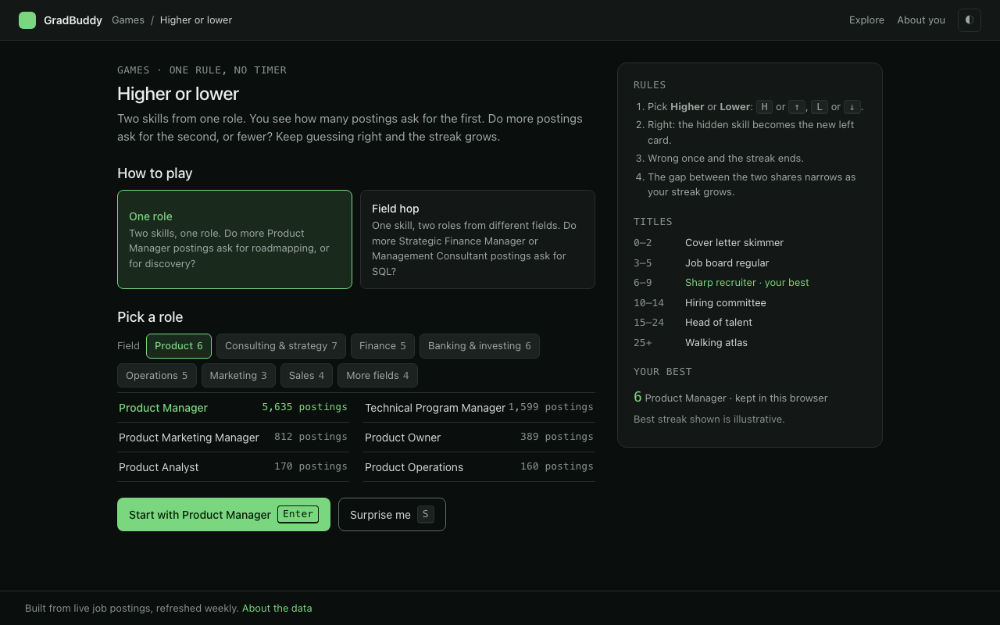
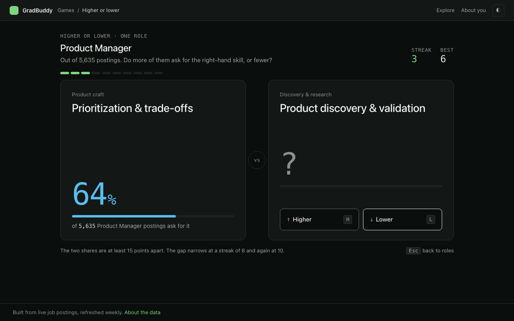
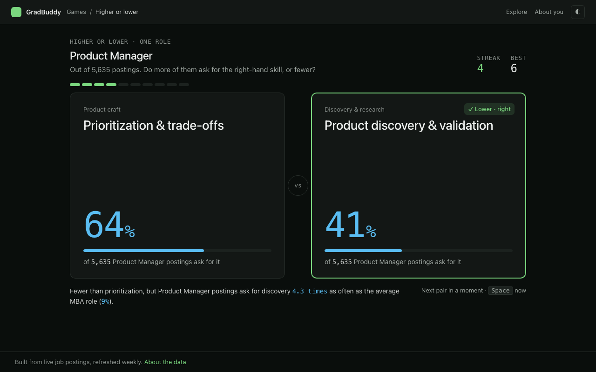
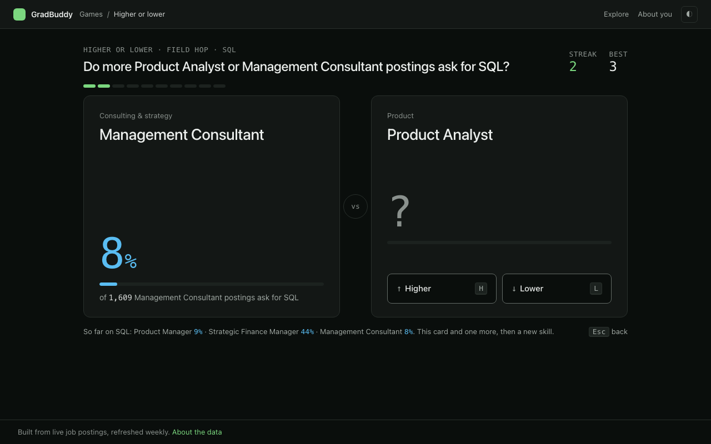
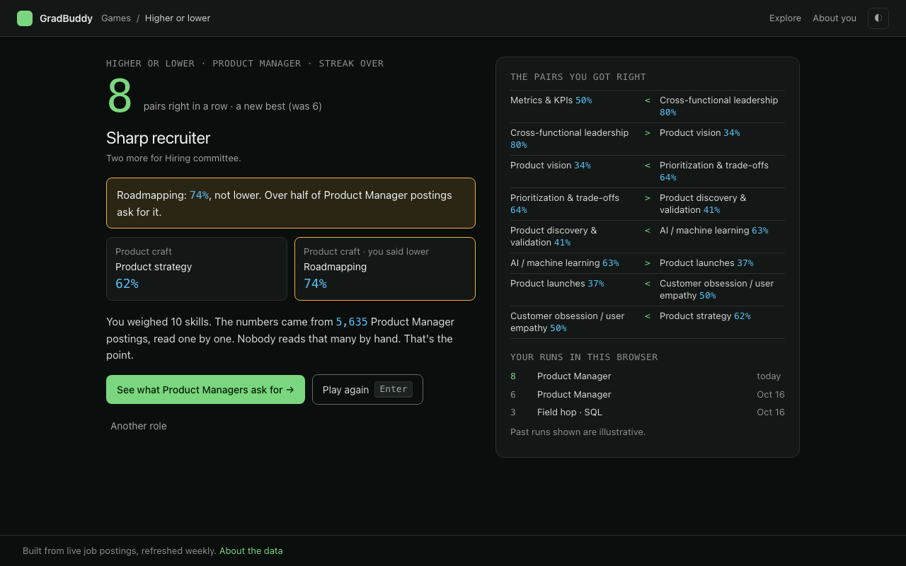

# Higher or lower

```json
{ "slug": "higher-or-lower", "title": "Higher or lower", "tagline": "Which skill do more postings want", "cover": "img/games/higher-or-lower.png", "status": "soon" }
```

The entry is the one already in `web/data/games.json` (6 words). The cover is `mocks/cover.png` (the pick screen).


## Pitch

Two skill cards for one role. The left card shows its share: "Prioritization & trade-offs · 64% of 5,635 Product
Manager postings". The right card hides its number: "Product discovery & validation · ?". Higher or lower? Get it
right and the hidden card moves to the left, a new skill appears, and the streak grows. Get it wrong once and the
run ends with the number you missed, the pairs you got right, a title for your streak, and a link into the role.

Every number on every card is a real share from the atlas. A student who plays three runs has seen thirty of a
role's skills ranked by how many postings ask for them, which is what the role screen shows, learned one guess at a
time.

## Why it's fun

- **One verb, one rule.** Higher or lower. No setup, no timer, no reading. A run starts with one key.
- **Your intuition is on trial.** Most players arrive with a picture of a job ("PMs write SQL"). The cards test it.
  Product Manager postings ask for SQL in 9% of 5,635 postings; Product Analyst postings in 59% of 170. The
  surprises are the fun, and they are the lesson.
- **Short runs, permanent stakes.** One wrong pick ends the run. A guesser with no knowledge gets one pair right
  at the median (see "Pair selection"), so a streak of 6 means something.
- **A title, not a score.** "Sharp recruiter" reads better than "7", and it says what the streak means.
- **It gets harder exactly when you get good.** The gap between the two shares narrows as the streak grows, from
  at least 25 points to 8 to 14.

## Rules

1. Pick a mode (One role or Field hop) and, for One role, a role. "Surprise me" picks a role at random.
2. The left card shows a skill and its share of the role's postings. The right card shows a skill and hides its share.
3. Pick **Higher** (more postings ask for the right-hand skill) or **Lower** (fewer do).
4. Right: the right-hand card's share is revealed, the card moves to the left, and a new hidden card is dealt. The
   streak goes up by one.
5. Wrong: the run ends. The end screen shows the number you missed, every pair you got right, your streak and title,
   and your best.
6. The two shares on screen are never equal and never closer than 8 points.

## A round, step by step (One role)

1. **Start** (`01-start`). The player picks a mode and a role. Fields are chips with the number of playable roles;
   the roles of the chosen field are listed with their posting counts. If the person answered "Tell us about you",
   their fields come first and the first role of their first field is preselected; otherwise Product Manager is.
   The side card shows the rules, the titles, and the player's best (from `localStorage`).
2. **Deal.** The first left card is a skill whose share leaves room both above and below it (at least one unused
   skill 8 or more points higher and one 8 or more lower), so the first pick is a real choice.
3. **Pick** (`02-pick`). Two cards side by side. Left: skill area (text), skill name, the share in blue with a blue
   bar, "of 5,635 Product Manager postings ask for it". Right: area, name, "?", and the two buttons. A line under
   the cards says the current minimum gap ("at least 15 points apart") and when it narrows next.
4. **Reveal, right** (`03-correct`). The hidden share counts up to its value (no count-up with reduced motion), the
   card gets a green border and "Lower · right". One line under the cards puts the number in context: how often this
   role asks for the skill against the average MBA role. After 1.4 seconds (or Space) the right card slides left and
   a new hidden card is dealt.
5. **Reveal, wrong** (`04-streak-over`). The run ends on the end screen at once.





### Field hop (variant, `05-field-hop`)

The same engine with the axes swapped: one skill, two roles. "Do more Product Analyst or Management Consultant
postings ask for SQL?" Each card is a role (its field as text above the name) with its share for the skill. The
right card's role is from a different field than the left card's whenever one is available, so the comparison
crosses fields. After 4 comparisons on one skill the skill changes: the next left card is a fresh, revealed card of
the new skill (a one-line notice says so), and the streak carries on. A line under the cards lists the shares seen
so far for the current skill, which by the fourth card is a small cross-field profile of that skill.



**Decision: a One role game stays in one role.** It does not hop between roles as the streak grows. Reasons: the
end link goes to one role screen whose grid shows every card the player saw; the comparison "which skill does this
job ask for more" is the question a student has about a target role; and a role's pool is deep enough (41 to 82
skills at 10% or more; the shortest perfect-play deck is 26 pairs) that no player runs out. Cross-role comparison
is what Field hop is for, as its own mode, so a single run never mixes the two questions. Recommendation for the
owner: ship One role first, Field hop in the same PR if time allows (it is about 80 more lines on the same engine);
see "Open questions".

## Pair selection and the difficulty ramp

All shares are compared as the whole numbers the player sees (`Math.round(share * 100)`), so "41% vs 41%" can
never be dealt and the gap the player sees is the gap the rule used.

**The pool (One role).** The role's skills with a share of at least 10% (`Atlas.TIER.some`, the lowest row of the
role screen), skipping the `credentials` cluster and `yoe_` ids (the role screen's own exclusions). So every card in
a run is a skill the player will find on the role screen they are sent to. Each skill is dealt at most once per run.

**The gap bands.** The gap between the left card's share and the new hidden card's share must fall in the band for
the current streak:

| Streak | Gap (points) | What it feels like |
|---|---|---|
| 0 to 2 | 25 or more | Obvious if you know the role at all |
| 3 to 5 | 15 to 30 | You need a view of the role |
| 6 to 9 | 10 to 20 | You need to know it |
| 10 and up | 8 to 14 | Close calls |

**Direction is a coin flip.** Among the skills in the band, the dealer first picks "higher" or "lower" with equal
odds (if only one side has candidates, that side), then a skill on that side. Among those it prefers skills that
leave both directions open for the next pair, so the chain does not drift to the top or bottom of the role, where
the next answer would be forced.

**Relaxing.** If no unused skill fits the band, the band widens: the maximum grows by 6 points and the minimum drops
by 4 (never below 8), up to three times, then the maximum is lifted. If even that finds nothing, the deck is out
(see "Edge cases").

**Not trivial, not a coin flip.** Measured by `deal.js --sim` and a Python copy of the same dealer, over the 48
playable roles:

- A perfect player never runs out early: the shortest deck was 26 pairs, the median 53 (960 runs, 20 per role).
- A player who knows nothing about roles and always guesses "toward the middle" (higher when the left card is below
  the role's median share, lower otherwise) gets 58% of pairs right in the first band, 65% in the second, 60% in
  the third and 57% in the last, against 50% for a coin. Their median streak is 1, the 90th percentile 4, the best 18
  (9,600 runs, 200 per role). So knowing nothing gets you "Cover letter skimmer"; "Sharp recruiter" (6 or more)
  takes knowledge of the role.

**Ties.** The 8-point minimum means two shares on screen are never equal. If a later change allows it, both answers
count as right and the reveal says "Same share. Both count."

**Field hop pool.** A skill qualifies when at least 6 playable roles ask for it at 10% or more and its shares across
playable roles span at least 30 points: 110 skills do. A role card needs a share of at least 2%. A role that has no
value for a skill (a product family for a skill only the MBA set tags) has no card for it; it is never shown as 0%.
The same gap bands and the same coin-flip direction apply; each role appears once per skill.

`deal.js` in this folder is the reference implementation, run on the real data through `web/atlas.js`:

```
node games/higher-or-lower/deal.js                  # every playable role and its pool size
node games/higher-or-lower/deal.js pm fpa --seed 7  # a perfect-play deal of 12 pairs per role
node games/higher-or-lower/deal.js --hop --seed 7   # a field-hop deal
node games/higher-or-lower/deal.js --sim            # the numbers above
```

## Scoring and rank titles

The score is the streak: the number of pairs right in a row. One title per streak, shown on the end screen, on the
start screen next to the best, and announced when a new title is reached during a run ("Sharp recruiter" appears
for a second above the cards).

| Streak | Title |
|---|---|
| 0 to 2 | Cover letter skimmer |
| 3 to 5 | Job board regular |
| 6 to 9 | Sharp recruiter |
| 10 to 14 | Hiring committee |
| 15 to 24 | Head of talent |
| 25 and up | Walking atlas |

The bands of the title table line up with the gap bands: the title changes when the game gets harder.

## End screen and punchline



- The streak, big, in green; "a new best (was 6)" when it is one. The title and how far the next one is ("Two more
  for Hiring committee").
- The reveal, in an amber box: "Roadmapping: 74%, not lower. Over half of Product Manager postings ask for it." The
  second sentence uses the role screen's own row names: over half (50% or more), a quarter to a half (25 to 49),
  one in ten to one in four (10 to 24), fewer than one in ten (field hop only).
- The missed pair as two small cards (the one picked against in amber).
- **The punchline**, with the role's real posting count: "You weighed 10 skills. The numbers came from 5,635 Product
  Manager postings, read one by one. Nobody reads that many by hand. That's the point." For a field hop it names
  the roles' total, summed over the roles dealt: "The numbers came from the postings of <k> roles, <n> of them."
- Actions: **See what Product Managers ask for →** (`#/role/<id>`), **Play again** (Enter, same role and mode),
  **Another role** (back to the start screen).
- Side card: "The pairs you got right", each as "left share < or > right share", and "Your runs in this browser"
  (the last 5 runs: streak, role or skill, date).

In the mock, the run is a real chain from the Product Manager data that respects every gap band: Metrics & KPIs 50%,
Cross-functional leadership 80%, Product vision 34%, Prioritization & trade-offs 64%, Product discovery & validation
41%, AI / machine learning 63%, Product launches 37%, Customer obsession / user empathy 50%, Product strategy 62%,
then Roadmapping 74% picked as lower. The best of 6 and the past runs are illustrative.

## Why this teaches the data

- **It is the role screen, one pair at a time.** The pool is exactly the skills of the role screen's three rows,
  and the end link opens that screen. A player who lost on Roadmapping finds it in the top row.
- **It corrects the picture students bring.** The cards are where intuition and postings disagree, and the reveal
  is a number with a count behind it ("of 5,635 postings"), never an opinion.
- **The context line teaches what is distinctive.** "Product Manager postings ask for discovery 4.3 times as often as
  the average MBA role (9%)" is the atlas's measure of what defines a role (the mean share over the 50 MBA roles),
  said in words. It separates "everyone asks for it" (communication) from "this role asks for it".
- **Field hop teaches where a skill pays.** Four cards on SQL show that it is a Product Analyst and Business
  Intelligence ask (59% and 70%) and rare in consulting (Management Consultant 8%).
- **The ending makes the atlas's point.** The player weighed ten skills; the atlas read thousands of postings to know
  the answers. That is the product.

## How it sends people into the atlas

- End screen: **See what <role> postings ask for →** opens `#/role/<id>` (One role), or the role of the missed card
  (Field hop). This is the primary button.
- Every skill in "The pairs you got right" links to the same role screen (the screen has no per-skill URL today; see
  "Out of scope").
- The start screen puts the person's own fields first when "Tell us about you" was answered, so the game warms up
  the roles they care about.

## Data sources

Everything comes from files the site already loads, through `web/atlas.js`. No new data, no pipeline change.

| What | File and field | How it is read |
|---|---|---|
| MBA roles | `web/data/graph_mba.json` `roles{}`: `label`, `n`, `small`; `groups[]`: `id`, `label`, `families` | `Atlas.index()` → `ix.M.roles`, `ix.M.groups`, `ix.groups` (labels) |
| MBA shares | `graph_mba.json` `skills[].by_family[<role id>]` | `ix.M.skills` |
| Product roles | `web/data/graph.json` `families{}`; posting count per family | `Atlas.product()` → `P.G.families`; `ix.roles[f].n` (set by `product()`) |
| Product shares | `graph.json` `skills[].by_family[<family>]` | `P.G.skills` |
| Skill names and areas | `skills[].name`, `skills[].cluster`; `clusters{}.label` | `ix.skillById`, `P.skillById`, `ix.M.clusters`, `P.G.clusters` |
| Average MBA role (context line) | mean of `by_family` over the 50 MBA roles | `ix.baseline[<skill id>]` (computed by `Atlas.index()`) |
| The person's fields | `localStorage` `you.fields` (written by "Tell us about you") | read with try/catch, as `app.js` does |

**How a share is computed.** `by_family[r]` is the share of the role's postings that ask for the skill. For MBA
roles it is company-balanced (each posting carries weight `w` so that one employer counts for at most 5% of a role;
`meta.shares.cap`), over all US postings of the role, open and closed. For product families it is unweighted, over
all postings of the family in every country. Both equal what the role screen shows with "All levels" and all
employers: checked by recomputing `Atlas.shares(jobs).share(id)` from the postings, for example Roadmapping in
Management Consultant (0.1202 both ways) and in Product Manager (0.7413 both ways). The game shows
`Math.round(by_family * 100)`.

**The card's count** ("of 5,635 postings") is `ix.M.roles[f].n` for an MBA role and the family's posting count for a
product family; these are the counts the shares are computed over.

**Reuse.** `Atlas.index()`, `Atlas.product()`, `ix.baseline`, `ix.skillById` / `P.skillById`, `Atlas.TIER.some`
(0.10), `meta.shares.small` (60). Do not reimplement shares from postings, and do not load role files
(`graph_mba/<role>.json`): the index holds every number the game needs.

**Loading.** `graph_mba.json` is 1.8 MB and loads first; every MBA role is playable as soon as it has. `graph.json` is
9.4 MB. Start `Atlas.product()` when the game mounts, without waiting for it; the six product roles show "loading"
on the start screen until it resolves. Product Manager is the default role only once it has loaded; until then the
default is the first role of the person's fields, else Management Consultant. The site may already have it in
cache (Explore starts it too).

**What is playable: 48 roles in 11 fields.** 42 MBA roles and 6 product families. Left out: the 5 MBA roles with
fewer than 60 postings (`small`: Digital Transformation Manager, M&A Integration Manager, Venture Capital Associate,
Real Estate Acquisitions Associate, Real Estate Development Manager), the MBA set's own Product group (the Product
field opens the product set, as everywhere in the atlas), and the MBA role `pmm`, see "Edge cases".

## Edge cases

- **Two roles with the id `pmm`.** *(Fixed 2026-10-18: product families are now `product.<family>` in `ix.roles`, so `ix.roles.pmm` is always the MBA role; see PLAN.md v10.)* The MBA Product Marketing Manager (Marketing) and the product family Product
  Marketing Manager share the id. `Atlas.product()` writes the product family into `ix.roles.pmm`, so after it loads
  `#/role/pmm` opens the product family. The game reads MBA roles from `ix.M.roles`, keys every role as
  `<set>:<id>`, and leaves the MBA `pmm` out so every run ends in a role screen that matches its cards.
- **Long skill names.** Some names run to 65 characters ("Market data platforms (Bloomberg, Capital IQ, FactSet,
  PitchBook)"). The card shows the part before the parenthesis at full size and the parenthesis on a second, smaller
  line; at most three lines, never truncated mid-word.
- **The deck runs out.** It cannot in practice (shortest perfect-play deck: 26 pairs), but if `next()` returns null
  the run ends as a win: "Every pair dealt. You know Product Manager postings better than most recruiters." The streak
  counts as normal.
- **Product data fails to load.** The product roles show "Could not load" and stay unplayable; the MBA roles work.
- **A skill a product family has no value for** (167 MBA-only skills) has no product card in Field hop; it is not 0%.
- **Same role label twice** (Product Marketing Manager in both sets): never both playable, see `pmm` above.
- **Repeat cards.** One Role never deals a skill twice in a run. Field hop never deals a role twice on one skill.
- **Leaving mid-run** (hashchange, Esc): the run is dropped and not saved; listeners and timers are removed.
- **Rapid key presses.** Input is ignored from the pick until the reveal finishes (about 0.6 s, or at once with
  reduced motion), so a double press cannot answer the next pair.
- **Theme.** Tokens only, so light and dark both work; the mocks show dark.

## Keyboard and accessibility

| Key | Action |
|---|---|
| `H` or `↑` | Higher |
| `L` or `↓` | Lower |
| `Space` | Skip the wait after a right pick |
| `Enter` | Start (start screen), play again (end screen) |
| `S` | Surprise me (start screen) |
| `Esc` | Back to the start screen |

- Both picks are real `<button>`s with visible focus (`:focus-visible` from `style.css`) and the key in a `<kbd>`.
  Keys are ignored when focus is in an input.
- One polite live region announces outcomes only: "Right. Product discovery and validation, 41%. Streak 4." and
  "Wrong. Roadmapping, 74%, not lower. Streak over at 8, Sharp recruiter."
- Colour is never the only cue: the verdict is in words ("Lower · right", "not lower"), the log uses `<` and `>`.
- The hidden card's "?" has `aria-label="Share hidden"`.
- `prefers-reduced-motion`: no count-up, no slide, no title flash; the reveal is immediate.
- No timer anywhere. The 1.4 s pause after a right pick only delays the next pair; Space skips it, and nothing is lost
  if it runs (the revealed card stays on screen as the new left card).
- Text sizes are the tokens' (13 px floor). Desktop only, as the rest of the atlas.

## Persistence

`localStorage` only, every access wrapped in try/catch (private windows, blocked storage); the game works without it.

- Key `hol-v1`: `{ best: { one: { "<set>:<id>": streak }, hop: streak, overall: streak }, runs: [{ mode, role | skill, streak, date }] }`,
  `runs` capped at the last 10.
- Key `hol-mode`: the last mode and role, to preselect them.
- Nothing leaves the browser.

## Out of scope

- A timed or 30-second mode (see "Open questions").
- Shared or global leaderboards; accounts.
- A per-skill URL on the role screen (the end link opens the role; the skill is not preselected).
- Level or employer-type filters on the shares (the game uses the role's "All levels" numbers).
- Mobile layout.
- Any change to `web/atlas.js`, `web/match.js`, the taxonomy, the pipeline or the data files; fixing the `pmm` id
  collision in `atlas.js` (worth its own fix, outside this game).

## Open questions for the owner

1. **Which modes ship first?**
   - A. One role only; Field hop later.
   - B. **Both, in one PR (recommended).** Same dealer and screens; Field hop adds about 80 lines and is the only
     mode that compares fields, which Explore cannot do one number at a time.
   - C. Field hop only. Weaker: the end link has no single role to send people to.
2. **Default role on the start screen when the person has not answered "Tell us about you".**
   - A. **Product Manager (recommended)**, once the product set has loaded (Management Consultant until then). The
     best-known role, the largest sample (5,635 postings).
   - B. A random playable role each visit. More variety, but a first-time player may get a role they cannot judge.
   - C. Management Consultant always. Loads instantly from the MBA index, no 9.4 MB wait.
3. **A timed variant, closer to the 403 game?**
   - A. **No timer (recommended).** Higher or lower is a thinking game; a timer punishes readers of long skill names
     and screen-reader users, and the streak already gives the stakes.
   - B. A 60-second "rush": as many right as you can, a wrong pick costs 5 seconds. A second leaderboard to keep.
4. **Pool floor.** 
   - A. **10% (recommended)**, the role screen's lowest row, so every card is on the screen the player is sent to.
   - B. 5%, which adds surprising lows (SQL at 9% of Product Manager postings) but cards the role screen does not show.

## Effort

About one day for one person: the dealer (port of `deal.js`, about 120 lines), the four screens and keyboard (about
300 lines), styles (`mocks/game.css`, about 110 lines, appended to `web/style.css`), half a day more with Field hop
and checks in both themes. No data or pipeline work.

## Files in this folder

- `README.md` — this spec.
- `PROMPT.md` — the build prompt for a fresh Claude Code thread.
- `deal.js` — the reference dealer and the measurements, on the real data.
- `mocks/01-start.html`, `02-pick.html`, `03-correct.html`, `04-streak-over.html`, `05-field-hop.html`, a PNG of each
  at 1280 × 800, `cover.png` (the pick screen), `game.css` (the proposed styles).
