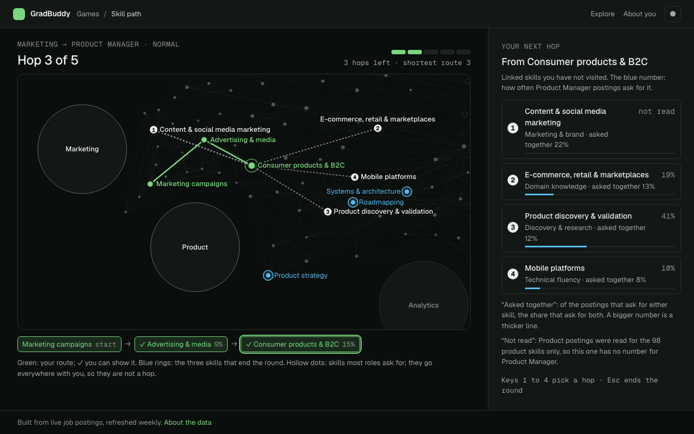
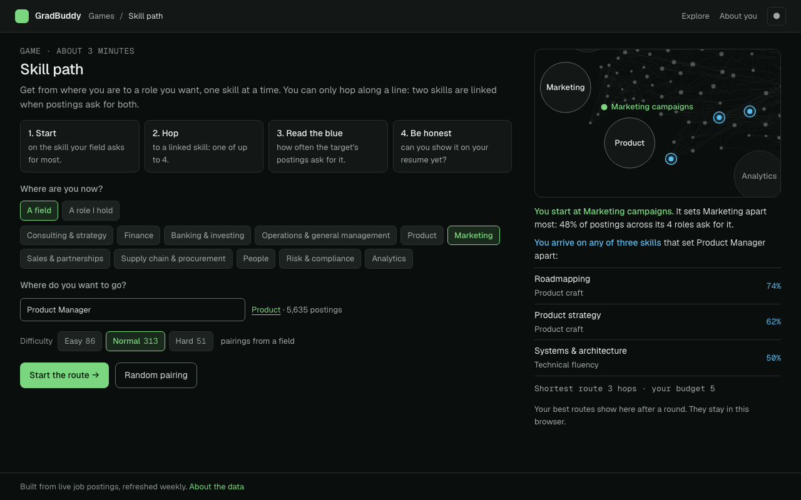
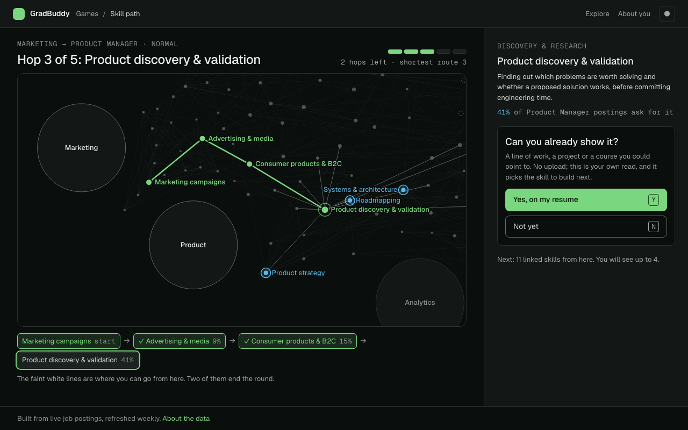
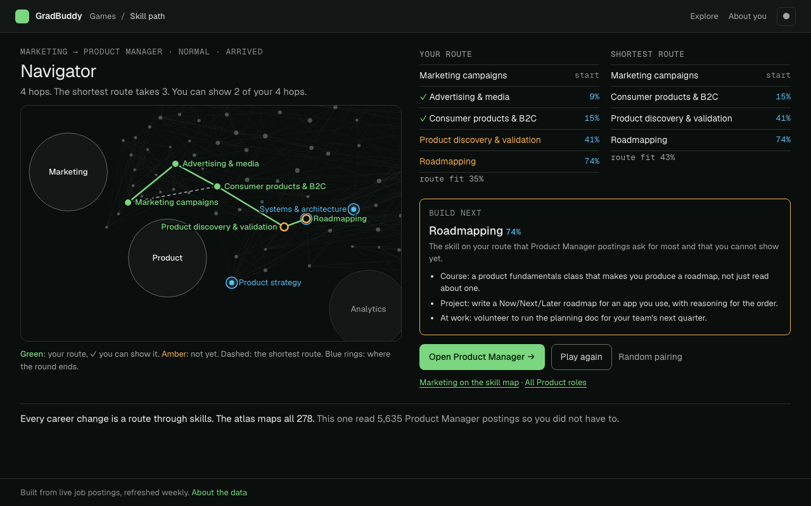
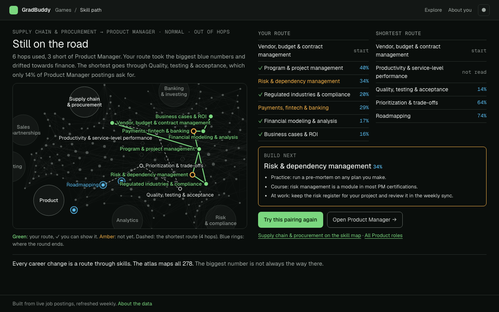

# Skill path

```json
{ "slug": "skill-path", "title": "Skill path", "tagline": "Hop from your field to a new role", "cover": "img/games/skill-path.png", "status": "soon" }
```

**One line.** Get from where you are (a field, or a role you hold) to a role you want by hopping between linked
skills on the atlas's skill map, inside a hop budget, and see how your route compares with the shortest one.



Design package only. Nothing here is built. `PROMPT.md` is the build prompt; `mocks/` holds five screens at
1280 × 800 on the real tokens, with real data baked in, and `mocks/cover.png` for the landing-page carousel.

---

## Why it is fun

- **One verb, one rule.** Hop. You may only hop along a line, and a line means postings ask for both skills. Four
  tiles on the start screen teach it, the way the inspiration teaches its rule with four example tiles.
- **A real puzzle, not a quiz.** The obvious move is to follow the biggest blue number (how often the target's
  postings ask for a skill). On the real graph that is wrong about half the time: a player who always takes the
  biggest blue number arrives in 56% of rounds at the normal budget (see Difficulty). The map is the second clue:
  skills sit near the fields that ask for them, so a hop that moves towards the target field usually helps. Reading
  both is the skill the game teaches.
- **Short and calm.** A normal round is 3 to 6 decisions and no timer. It suits MBA and grad students who want to
  think, not twitch.
- **Permanent stakes, the career kind.** A hop spent is spent. There is no undo, and a step back costs a hop.
- **A rank title, not a score.** Cartographer, Pathfinder, Navigator, Commuter, Scenic route, Still on the road.
- **The ending makes the atlas's point.** "Every career change is a route through skills. The atlas maps all 278."
  followed by the number of postings this one round read for you.
- **It is about you.** At every hop you say whether you can already show that skill. The end screen turns that into
  the one skill to build next, with its steps where the data has them, and a link into the target role.

## Rules

1. Pick where you are (a **field**, or **a role you hold**) and a **target role**, or take a random pairing.
2. You start on one skill: the start's most distinctive skill (see Data). The round ends when you land on any of the
   target's **three arrival skills**: the three skills that most set the target role apart.
3. Each turn the game shows **up to 4 linked skills** you have not visited. Pick one. That is a hop.
4. After each hop, say **"Yes, on my resume"** or **"Not yet"**. Nothing is uploaded; it is your own read.
5. You have a **hop budget**: the shortest route plus a margin set by the difficulty. When it runs out, the round ends
   where you stand.
6. Skills that most roles ask for (communication, ownership and six more; measured, see Data) are drawn on the board
   as hollow dots but are **not hops**: they go everywhere with you, so they cannot move you anywhere.

## A round, step by step (real data: Marketing → Product Manager, normal)

All numbers below come from `web/data/graph_mba.json` and `web/data/graph.json`, computed by the reference script
used for this package (rules exactly as in this README). The two Yes/Not yet answers per round are **illustrative**:
they are a player's own input, not data.

**Start screen** ([01-start](mocks/01-start.png)). Start: field Marketing. Start skill: **Marketing campaigns**, the
skill that sets Marketing apart most: 48% of postings across its 4 roles ask for it. Target: **Product Manager**
(product role set, 5,635 postings). Arrival skills: **Roadmapping** 74%, **Product strategy** 62%, **Systems &
architecture** 50% of Product Manager postings. Shortest route 3 hops; normal budget 5.



**Hop 1.** From Marketing campaigns the game shows (strongest link first; blue = share of Product Manager postings;
"together" = Jaccard of the link):

| Choice | PM postings | Together | Hops left to arrive after it |
|---|---|---|---|
| Advertising & media | 9% | 27% | 2 |
| Marketing measurement & attribution | not read | 26% | 3 |
| Creative development & agency management | not read | 20% | 3 |
| Consumer products & B2C | 15% | 13% | 2 |

The player takes Advertising & media (a good hop: it moves one closer) and says Yes.

**Hop 2.** From Advertising & media: Marketing measurement & attribution (not read, 20%), Digital & performance
marketing (not read, 17%), Consumer products & B2C (15%, 16%), **Mobile platforms** (10%, 7%). Only Mobile platforms
moves closer, and it has the second-smallest number of the four. The player takes Consumer products & B2C (sideways:
still 2 hops away) and says Yes. That is the hop the end screen will show as lost.

**Hop 3** ([02-play](mocks/02-play.png), the cover). From Consumer products & B2C: Content & social media marketing
(not read, 22%), E-commerce, retail & marketplaces (19%, 13%), **Product discovery & validation** (41%, 12%), Mobile
platforms (10%, 8%). The player takes Product discovery & validation.


**The check** ([03-check](mocks/03-check.png)). The panel shows the skill's definition and its share, and asks "Can
you already show it?" The player says Not yet. From here 11 linked skills remain; two of them are arrival skills.



**Hop 4.** From Product discovery & validation: Roadmapping (74%, arrival), Product strategy (62%, arrival),
Prioritization & trade-offs (64%), Customer obsession (50%). The player takes Roadmapping and says Not yet. Arrived.

**End screen** ([04-end](mocks/04-end.png)). 4 hops; the shortest route takes 3 (Marketing campaigns → Consumer
products & B2C → Product discovery & validation → Roadmapping), so the rank is **Navigator**. You can show 2 of 4 hops.
Route fit (the mean blue number of your hops) 35%; the shortest route's 43%. Build next: **Roadmapping**, 74%, the
skill on the route that Product Manager postings ask for most and that the player cannot show yet, with its three
build steps from the data. "Open Product Manager" goes to `#/role/product.pm`.



**A second real round, out of hops** ([05-out-of-hops](mocks/05-out-of-hops.png)). Supply chain & procurement →
Product Manager. Start skill Vendor, budget & contract management; shortest route 4 hops, budget 6. A player who
always takes the biggest blue number goes Program & project management (40%) → Risk & dependency management (34%) →
Regulated industries & compliance (20%) → Payments, fintech & banking (29%) → Financial modeling & analysis (17%) →
Business cases & ROI (16%) and stops 3 hops short. The shortest route goes Productivity & service-level performance
(not read) → Quality, testing & acceptance (14%) → Prioritization & trade-offs (64%) → Roadmapping (74%). This is the
lesson of the game in one picture: the biggest number is not always the way there.



## Scoring and rank titles

Three things are measured. Only the first two rank a round; the third never does, so nobody gains by saying Yes.

- **Hops over par.** Par = the shortest route's hop count.
- **Route fit.** The mean target share over the skills you hopped onto (the start is not counted; a "not read" skill
  is left out of the mean). It breaks ties and decides Cartographer.
- **Hops you can show.** The count of Yes answers. Shown on the end screen, used for "build next", not ranked.

| Rank | When |
|---|---|
| Cartographer | arrived on par, route fit at least the shortest route's |
| Pathfinder | arrived on par |
| Navigator | arrived, 1 over par |
| Commuter | arrived, 2 over par |
| Scenic route | arrived, 3 or more over par (only possible on easy) |
| Still on the road | out of hops |

Order for the personal leaderboard: arrived first, then fewer hops over par, then higher route fit, then the most
recent.

## Difficulty

Two dials: how far apart start and target are (par), and the margin in the budget.

| Level | Par | Budget | Help | Random pairings from a field | from a role |
|---|---|---|---|---|---|
| Easy | 2 | par + 3 | the choice that moves closer is marked "towards the target" | 90 | 474 |
| Normal | 3 or 4 | par + 2 | none | 319 | 1,425 |
| Hard | 5 or 6 | par + 1 | none | 51 | 226 |

Pairings counted with every rule in this README; target roles marked `small` in the index (5 roles with few
postings) are left out of random pairings but can be picked by hand. Pairings with par 0 (the start skill already is
an arrival skill: 5 from a field, 45 from a role) are refused with a line that says so; par 1 (25 and 169) can be
picked by hand but are never dealt at random.

How hard is it, measured over every pairing (3,225 with par 1 or more) by simulated players that always take an
arrival skill when one is shown:

| Budget | Random hops | Biggest blue number | Hop nearest the target on the map | Perfect |
|---|---|---|---|---|
| par + 1 | 23% | 49% | 49% | 100% |
| par + 2 | 28% | 56% | 57% | 100% |
| par + 3 | 32% | 60% | 63% | 100% |

So a careless player rarely arrives, one clue alone gets about half way, and a player who reads both the blue number
and the map, and looks one hop ahead (hover shows a choice's own links), does better. Easy always arrives if you
follow the marker.

## End screen and punchline

- The rank title, then one sentence: hops used, par, how many hops you can show.
- The board with your route (green; amber rings for Not yet) and the shortest route (dashed).
- Your route and the shortest route side by side, each skill with its blue number; route fit under each.
- **Build next**: the skill on your route marked Not yet with the highest target share, leaving out industries
  (`domain` skills) and "not read" skills. If you said Yes to every hop, the arrival skill you reached (out of hops:
  the arrival skill nearest to where you stopped). Its build steps where the data has them (see Data).
- Buttons: "Open <target> →" (`#/role/<id>`), "Play again" (same pairing), "Random pairing".
- Punchline, always the same first sentence: **"Every career change is a route through skills. The atlas maps all
  278."** Second sentence: "This one read 5,635 Product Manager postings so you did not have to." (the target's
  posting count); after a lost round: "The biggest number is not always the way there."

## How it sends people into the atlas

- End screen: "Open <target role> →" `#/role/<id>`; the build-next skill names the role screen as the place to see
  how postings word it.
- End screen, small links: "<start field> on the skill map" `#/explore?field=<group>` and "<target field>" `#/field/<group>`.
- Start screen: "See all roles in <field>" `#/field/<group>` next to the target picker.
- Any skill name on the end screen links to the role screen of the target (`#/role/<id>`). A deep link to one
  skill's side panel does not exist yet (see open questions).

## Data sources

All files are read through `web/atlas.js` and `web/skillmap.js`; the game adds no data file.

| What | File and fields | How |
|---|---|---|
| The board: skills and positions | `graph_mba.json` `skills[]` (id, name, cluster, share, what) | Positions are the skill map's own layout (`computeLayout` in `skillmap.js`, the same seed and cache key), so the board is the Explore map. |
| The links | `graph_mba.json` `edges[]` {source, target, jaccard} | 1,272 links. Links touching a `credentials` skill (28 skills, also `yoe_*`) are dropped, as the grid drops them; links touching a generic skill are dropped. That leaves **240 skills and 936 links** in one connected piece; every skill on it has at least 2 links (median 7, most 25). Two skills, Healthcare & life sciences and Adaptability & fast-paced environments, are linked only to generic skills and drop off the board. |
| Generic skills (not hops) | `Atlas.genericSkills()` | Asked by most postings (share ≥ 0.5 in `defining` or `asks`) of at least half the MBA roles. Today 8: collaboration, communication, cross-functional leadership, execution, influence, ownership, problem solving, stakeholder management. Same set with 47 or 48 MBA roles counted (see pmm below). |
| Fields | `graph_mba.json` `groups[]` (11, with `families`); `Atlas.index().groups` | Field share of a skill = mean share over the field's roles (`fieldShares` in `skillmap.js`); the Product field uses the six product families of `graph.json`, as `productShares` does. |
| Start skill, from a field | field shares | The skill with the highest `w × min(4, w / mean over the 11 fields)`, with `w ≥ 0.05`, not generic, not `domain`, on the board. This is `topSkills` in `skillmap.js` minus the two exclusions. |
| Start skill, from a role | role shares | The role's first arrival skill (next row). |
| Target share (blue) | MBA role: `skills[].by_family[<role>]` in `graph_mba.json` (company-balanced). Product role: `skills[].by_family[<family>]` in `graph.json`. | Exactly the number the role screen shows for the whole role. |
| Arrival skills | target shares and `Atlas.index().baseline` (mean share over the 50 MBA roles) | The three skills with the highest `share × min(4, share / baseline)`, with share ≥ 0.25, not generic, not `domain`, not credentials, on the board. For Product Manager: Roadmapping, Product strategy, Systems & architecture. Every one of the 53 pickable roles has three. |
| Shortest route | the board | BFS from the three arrival skills (multi-source), so `dist[s]` is hops to arrive from any skill. Par = `dist[start]`. Of the routes with par hops, the one with the highest sum of target shares, then the highest sum of Jaccard; that route is drawn on the end screen. |
| Choices at a hop | the board, `dist` | Unvisited neighbours of the current skill. First pick: a neighbour with `dist` one less (the one with the highest target share; if none is unvisited, the neighbour with the smallest `dist`). Then fill to 4 with the strongest links (Jaccard). Show them strongest link first, so the one that moves closer is not always in the same place. If no neighbour is unvisited, offer "Step back" (costs a hop). In the simulations at par + 2 this happened in 3 of 3,225 rounds of random play and 3 of biggest-blue-number play, never for the map or perfect players. |
| Build steps | `skills[].build` in `graph_mba.json` | A list of strings for the 98 product skills (73 of them on the board); an object keyed by ladder for 3 MBA skills (Valuation, Client coverage, Credit analysis; key `bank`), shown when the target role's `ladder` matches; otherwise the line the role screen uses: "Build steps for this skill are not written yet." |
| Posting count in the punchline | MBA: `roles.<id>.n_open`; product: the family's postings in `graph.json` (`Atlas.index().roles[id].nOpen` after `Atlas.product()`) | |
| Total skills in the punchline | `graph_mba.json` `skills.length` (278) | Read, not hard-coded. |

Reuse, do not copy: `Atlas.index()`, `Atlas.product()`, `Atlas.genericSkills()`, `ix.baseline`, `ix.skillById`,
`ix.roles`, `ix.groups`; from `skillmap.js` the layout, field shares and adjacency that `load()` already builds. They
are private today; the build adds one read-only export (`SkillMap.board()`, see `PROMPT.md`) instead of a second copy
of the layout code. The game draws its own SVG on that data and never calls `SkillMap.stage()`.

## Edge cases

- **Product and MBA role ids.** The 98 product skills share ids with the MBA index, so one board serves both sets.
  `Atlas.index()` hides the MBA "Product" group (`product_manager`, `product_strategy`), and `Atlas.product()` then
  writes the six product families into `ix.roles` as `product.<family>` (the MBA Marketing group has its own `pmm`;
  until 2026-10-18 the product family overwrote it). The game uses `ix.roles` after `await Atlas.product()`, like
  the role screen, so `pmm` is the MBA PMM, `product.pmm` the product PMM, and each id opens its own `#/role/<id>`.
  54 roles are pickable (48 MBA, 6 product); the atlas says "56 kinds of roles" counting the set definitions.
- **"Not read".** Product postings were tagged against the 98 product skills only, so the 180 MBA-only skills have
  no share for a product role. On a product target, 167 of the 240 board skills show "not read" instead of 0%. They
  count as 0 when choosing the shortest of several equal routes, are left out of route fit, and are never "build
  next". A line on the play screen says why. See open question 1.
- **Small roles.** 5 roles are `small` in the index (Digital Transformation Manager, M&A Integration Manager, Venture
  Capital Associate, Real Estate Acquisitions Associate, Real Estate Development Manager). Shares rest on few
  postings: never dealt at random; picked by hand they show the role screen's own small-role note.
- **Same field.** A field start cannot target one of its own roles; a role start cannot target itself.
- **Par 0 and 1.** See Difficulty.
- **Closed postings** count in every share (the atlas's rule); the game lists no postings, so nothing to hide.
- **Data refresh.** Pars, choices and the example rounds change when `graph_mba.json` changes. The personal
  leaderboard stores the data's `meta.generated` with each round and greys out rounds from older data ("on older
  data") rather than deleting them.
- **Load order.** `Atlas.product()` is about 9 MB (`graph.json`). The start screen can render from the index alone;
  "Start the route" waits for `Atlas.product()` (needed for product targets, the Product field and `pmm`) and says
  "Loading the product postings…" while it does.

## Keyboard and accessibility

- Every action is a button. Keys: `1` to `4` pick a choice, `Y` / `N` answer the check, `B` steps back when offered,
  `Esc` ends the round (asks once), `Enter` on the end screen plays again.
- Focus moves to the question after a hop and to the first choice after an answer. A polite live region says each
  step: "Hop 3 of 5: Product discovery & validation. 41% of Product Manager postings ask for it."
- The board is `role="img"` with a text alternative ("Your route: … Arrival skills: …"); the choices panel is the full
  interface, so the game is playable without seeing the map.
- Colour never carries meaning alone: Yes has a ✓, Not yet the words "not yet" and an amber ring; the shortest route
  is dashed; arrival skills are rings. Contrast and type come from the tokens; map labels use 13px, the token floor.
- `prefers-reduced-motion`: no drawing animation for the route.
- Both themes come from the tokens; the mocks are dark.

## Persistence

`localStorage` key `game-skill-path`, every read and write wrapped in try/catch (the pattern of `store` in
`app.js`); the game works with storage blocked. Stored: the last 20 rounds and the best round per pairing
(`<field|role>:<start id>><target id>`, rank, hops, par, route fit, the day, `meta.generated`), and the last chosen
difficulty. Yes/Not yet answers are kept only for the round on screen, never stored. Nothing leaves the browser: no
request is made except the atlas's own data files. "Forget my routes" on the start screen clears the key.

## Out of scope

- A shared or global leaderboard, sharing a route, accounts.
- A timer or speed bonus.
- Reading a resume to answer the checks (the matcher could; the game stays a light self-assessment by design).
- Phone layout (desktop only, owner's decision).
- Changes to the matcher, taxonomy, pipeline or data files.
- A deep link to one skill's side panel on the role screen (see open questions).

## Open questions for the owner

1. **Blue numbers for MBA-only skills on a product target.**
   - **A (recommended).** Show "not read". The number always matches the role screen the game links to, and it keeps
     the atlas's v10 rule (the product field's shares come from the product set). Cost: on product targets most
     marketing, finance and operations hops have no blue number.
   - B. Use the MBA set's own Product Manager role (`graph_mba.json` `product_manager`, 3,657 postings, all 278 skills
     read) for every skill. Every hop has a number, but numbers differ from the role screen (Systems & architecture:
     29% there, 50% on `#/role/pm`), and that role is hidden everywhere else.
   - C. Use B only for MBA-only skills. Every hop has a number, but two sources mix on one screen; not advised.
2. **What counts as arriving.**
   - **A (recommended).** Any of the target's three most distinctive skills. Clear on the map (three blue rings),
     and par spreads from 1 to 6.
   - B. Only the single most distinctive skill. Longer, harder rounds; more rounds lost.
   - C. Any skill at least half the target's postings ask for. Rounds get short and the generic-looking skills win.
3. **Generic skills.**
   - **A (recommended).** On the board as hollow dots, not hops. Par barely moves (measured over the 530 pairings from a
     field: mean par 3.2 without them, 3.1 with them), and it teaches that communication goes everywhere.
   - B. Normal hops. Players who follow the blue number get stuck circling communication, ownership and
     stakeholder management (seen in the simulations): high numbers for every target, no progress.
4. **The start from a field.**
   - **A (recommended).** The field's most distinctive skill, shown before the round.
   - B. Let the player pick one of the field's three most distinctive skills. More agency, one more decision before
     play starts.
5. **Deep link to a skill.**
   - **A (recommended).** Not now: "Open <role>" goes to `#/role/<id>` and the player opens the skill there.
   - B. Add `#/role/<id>?skill=<sid>` to `app.js` so build next opens the skill's side panel directly. Small, but it
     touches the role screen, which is outside this game.
6. **Daily pairing.**
   - **A (recommended).** Not in v1.
   - B. One seeded pairing per day for everyone (same start, target and choices), still scored only on the device.

## Effort

About 2 days of one Claude Code thread: the game logic and an eval for it (0.5 day), the three screens and the board
drawing (1 day), keyboard, live region, storage and polish (0.5 day). Lines: about 450 in `web/games/skill-path.js`,
about 90 of CSS, about 10 in `skillmap.js` for the export, about 10 in `app.js` and `index.html` for the route and
the script tag (or none, if the landing page's `#/play/<slug>` dispatch already exists), about 120 in the eval.

## Files here

- `README.md` this spec · `PROMPT.md` the build prompt
- `mocks/01-start.html` start screen · `mocks/02-play.html` a hop (cover) · `mocks/03-check.html` the Yes / Not yet
  check · `mocks/04-end.html` arrived · `mocks/05-out-of-hops.html` a lost round · a `.png` of each ·
  `mocks/cover.png` (= 02-play) for `img/games/skill-path.png`. The mocks carry their own `sp-*` styles in a `<style>`
  block: that block is the starting point for the section appended to `web/style.css`.
