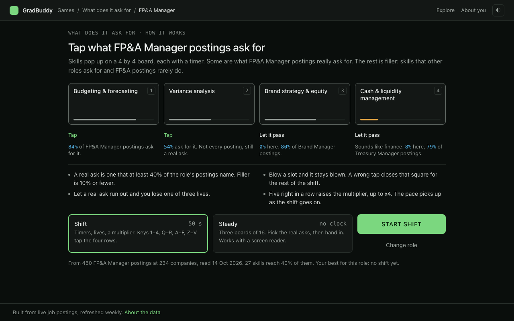
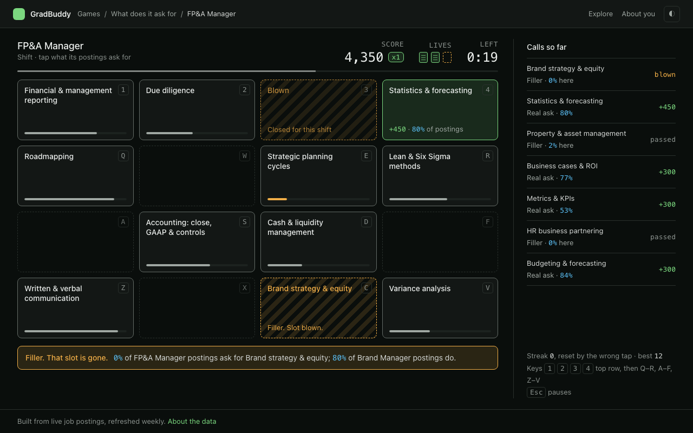
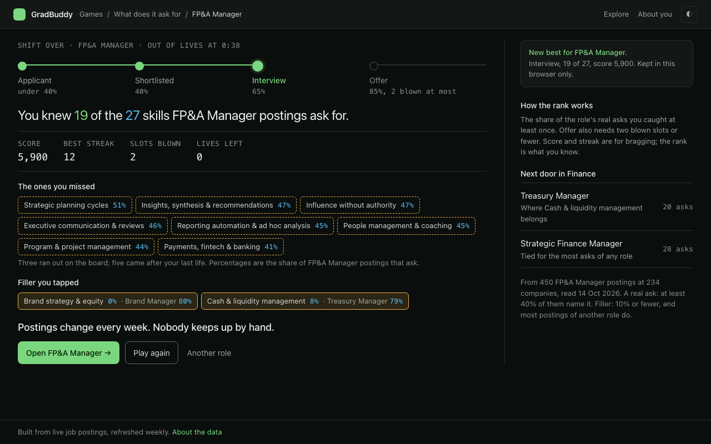
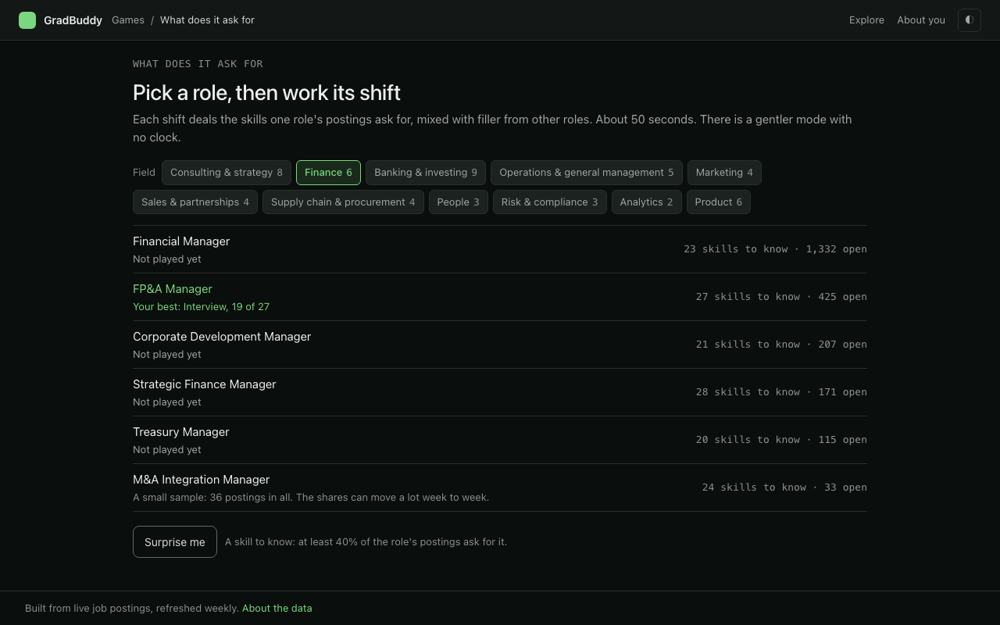
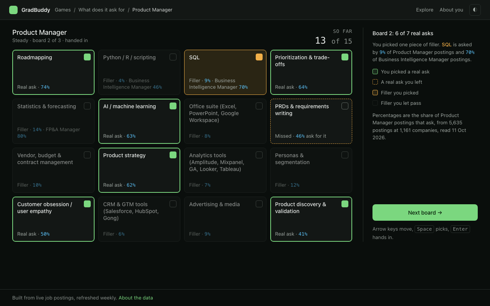

Retired in v12 (2026-10-20): merged into Know the role; see PLAN.md.

# What does it ask for

Proposed entry for `web/data/games.json` (the shape the landing carousel reads; the current working tree already carries this line):

```json
{ "slug": "what-it-asks", "title": "What does it ask for", "tagline": "Tap the real asks, let filler pass", "cover": "img/games/what-it-asks.png", "status": "soon" }
```

Route: `#/play/what-it-asks`. Status: design package, not built. Build prompt: [PROMPT.md](PROMPT.md). Pool script: [pools.js](pools.js) (`node games/what-it-asks/pools.js fpa pm`).


## Pitch

Pick a role, say FP&A Manager. Skills pop up on a 4 by 4 board, each with a draining timer. Tap the ones FP&A postings really ask for; let the filler pass. A wrong tap blows that slot for the rest of the shift. Let a real ask run out and you lose a life. The pace picks up. About 50 seconds later you get a rank on a hiring ladder (Applicant, Shortlisted, Interview, Offer), the line "You knew 19 of the 27 skills FP&A Manager postings ask for", the ones you missed as chips with their real shares, and a button into the role's page.

It is the infisical.com/403 reflex game turned into a career lesson: the filler is not random noise but skills that other roles' postings ask for, so every wrong tap teaches something ("Cash & liquidity management: 8% of FP&A Manager postings, 79% of Treasury Manager postings").

## Why it is fun

- **One rule, read in a second.** Tap the real asks, leave the rest. No reading a posting, no typing.
- **The near misses are the content.** Filler is chosen to sound right. Late in a shift the decoys come from the same field (Treasury and Corporate Development skills on an FP&A board), so a finance student gets caught by finance words.
- **Loss you can see.** A blown slot stays hatched in amber; the board shrinks as you get greedy. Tapping everything blows the board long before the bell.
- **A rank, not only a score.** "Interview" is something an MBA student wants to beat. The rank counts what you knew; the score and streak are for bragging.
- **Short and repeatable.** 50 seconds, a personal best per role, and 53 roles to try. "Play again" is one key.
- **It makes the atlas's point.** The end card says "Postings change every week. Nobody keeps up by hand." and hands you the role's page.

## Rules

1. A **real ask** is a skill that at least 40% of the role's postings name. Tap it before its timer runs out.
2. **Filler** is a skill that 10% or fewer of the role's postings name (15% for the thin product pools, see Data sources) and that most postings of some other role do. Let it pass.
3. **Wrong tap**: the slot is blown for the rest of the shift (hatched amber, nothing spawns there again), and your streak resets. No life is lost.
4. **Missed ask**: a real ask that runs out costs one of three lives, and resets your streak.
5. Filler that runs out untouched is fine: it just leaves.
6. The shift ends at 50 seconds, at the third lost life, or when all 16 slots are blown.

## A shift, step by step

1. **Pick a role** (`04-pick-role`). Fields as chips (the 11 fields of the atlas, in `Atlas.index().groups` order), roles of the field as rows with "N skills to know" and open postings, and your best for each role if any. "Surprise me" picks a random non-small role. If the visitor told the site their fields (`localStorage["you"].fields`, written by `#/you`), the first of those fields is selected; otherwise the first field.
2. **How it works** (`01-how-it-works`). Four example tiles built from the chosen role's own data: its two strongest non-generic asks (Tap), one far filler and one same-field decoy (Let it pass), each with the real share in blue. Four rules, the two modes, START SHIFT, Change role, and the data line (postings, companies, date read, how many skills reach 40%).
3. **The shift** (`02-shift`). A 3-2-1 count (skipped under reduced motion), then 50 seconds of spawns. The HUD shows role, score with multiplier, lives as three small resume shapes, and time left; a thin bar shows the shift's progress. A right column, "Calls so far", logs each resolved tile with its share, so the lesson lands while you play. A feedback strip under the board explains the last mistake in one sentence.
4. **Shift over** (`03-shift-over`). Rank ladder, "You knew X of the N skills … ask for", stats, missed asks as chips, filler you tapped as chips with where it belongs, the punchline, and the three buttons.

## Timers and spawns

The shift is 50 seconds in four stages. Spawn interval and tile life shrink together, so the board holds about four to five live tiles on average and up to the cap in bursts.

| Stage | Clock | Spawn every | Tile life | Live tiles at most | Spawns (about) |
|---|---|---:|---:|---:|---:|
| 1 | 0:00–0:10 | 1.10 s | 4.0 s | 5 | 9 |
| 2 | 0:10–0:25 | 0.85 s | 3.4 s | 7 | 17 |
| 3 | 0:25–0:40 | 0.65 s | 2.9 s | 9 | 24 |
| 4 | 0:40–0:50 | 0.50 s | 2.5 s | 10 | 20 |

These are design values to tune in play, not data. A scratch simulation of the schedule gives 70 spawns for a full shift.

- **Where a tile lands**: a random free slot (not live, not blown). If no slot is free, the spawn waits for the next tick.
- **The deal**: the whole sequence of 70 spawns is built when the shift starts. `R = max(asks, 21)` positions are real asks, spread evenly over the sequence (the last real position no later than spawn 66, so it has time to be caught). The first pass deals every ask of the role once, in shuffled order; roles with fewer than 21 asks get a second pass (shuffled again). The same skill is never live twice, and never dealt twice in a row.
- **Filler difficulty** rises through the shift. Each filler skill gets a difficulty: 2 if the role that asks for it is in the same field (Cash & liquidity management on an FP&A board, from Treasury Manager), 1 if its lift over the mean is under 5 (a skill asked fairly widely, so more plausible), 0 otherwise (clearly another world: Property types on an FP&A board). Stage 1 draws difficulty 0, stage 2 up to 1, stages 3 and 4 prefer 1 and 2 and fall back to any. A filler skill repeats only once its pool is used up.
- **Timer bar**: neutral grey while more than 30% remains, amber in the last 30% (attention). It is not blue: blue means the postings' numbers.
- **Pause**: Esc, or the tab losing focus or visibility, pauses the shift and hides the board until Resume, so a pause cannot be used to read ahead.

## Scoring, multiplier, rank

| Event | Points | Streak | Other |
|---|---|---|---|
| Real ask tapped | 100 × multiplier, plus 50 × multiplier if tapped while its bar is above half | +1 | Tile shows "+N · 84% of postings" for 0.6 s |
| Generic ask tapped (one of the 8 skills every field asks for, see below) | 50 × multiplier, plus the same quick bonus | +1 | Same |
| Filler tapped | 0 | reset to 0 | Slot blown for the shift; feedback strip names where the skill belongs |
| Real ask runs out | 0 | reset to 0 | One life lost; logged as missed |
| Filler runs out | 0 | unchanged | Logged as passed |
| Shift ends with lives left | +200 per life | | |

- **Multiplier** = 1 + floor(streak / 5), at most x4 (x2 from 5 right in a row, x3 from 10, x4 from 15). Shown as "x3" in green beside the score.
- **Knew** = the number of the role's real asks you tapped at least once. **Total** = the role's real asks (27 for FP&A Manager). A full shift deals every one of them at least once, so the denominator is fair for every role; ending early (lives or slots) leaves some undealt, and those count as not known.
- **Rank** (on knew / total, plus blown slots):

| Rank | Needs |
|---|---|
| Offer | 85% or more, and 2 blown slots or fewer |
| Interview | 65% or more, and 4 blown slots or fewer |
| Shortlisted | 40% or more |
| Applicant | below 40% |

The cut-offs are a design choice to tune after a few playtests. In the mock, 19 of 27 is 70% with 2 blown, so Interview; FP&A Manager needs 23 of 27 for Offer.

Why the rank ignores score: score rewards speed and streaks; the rank should say what you know about the role, which is what the atlas is for.

## Difficulty and the gentle mode

**Shift** is the default. Difficulty rises inside a shift (pace and decoys), not between shifts. There is no level select: the role you pick is the difficulty. Roles in your own field are harder because their decoys sound right.

**Steady** (`05-steady`) is the mode for players who do not like time pressure, use a screen reader, or want to study a role. No clock, no lives, no blown slots.

- Three boards of 16 tiles. The role's real asks are split across the three boards (FP&A Manager 9, 9, 9; Product Manager 8, 7, 7; Operations Manager 4, 3, 3); the rest of each board is filler, rising in difficulty board by board.
- Click or Space toggles a tile; Enter hands the board in. The reveal marks each tile: green for a real ask you picked, dashed amber for a real ask you left, solid amber for filler you picked, dimmed for filler you let pass, each with its share and, for filler, the role that asks for it.
- Same end screen and the same rank rule, with filler picked counting as blown slots. No score, no streak: "Steady" shows "13 of 15 so far" instead.
- The mode is remembered per browser (`wia-mode`). Under `prefers-reduced-motion: reduce` the how-it-works card adds one line: "Prefer no clock? Try Steady."

## End screen and punchline

`03-shift-over`, left to right, top to bottom:

- Eyebrow: "Shift over · FP&A Manager · out of lives at 0:38" (or "end of shift", or "no slots left at 0:31").
- The ladder: four steps with their cut-offs; the reached step in green with a halo, the ones below filled green, the ones above grey.
- "You knew **19** (green, you) of the **27** (blue, the postings) skills FP&A Manager postings ask for."
- Stats in mono: Score, Best streak, Slots blown (amber if above 0), Lives left. Steady shows Boards and Filler picked instead.
- **The ones you missed**: every real ask not tapped, sorted by share, as dashed amber chips with the share in blue. A line under them says how many ran out on the board and how many came after the shift ended.
- **Filler you tapped**: solid amber chips: name, share in this role, and the role whose postings ask for it most, with its share.
- **Punchline**, fixed: "Postings change every week. Nobody keeps up by hand." (true of the atlas: the data is refreshed weekly).
- Buttons: **Open FP&A Manager →** (`#/role/fpa`, primary), **Play again** (same role and mode, straight to the count), **Another role** (the picker).
- Right column: "New best for FP&A Manager" when it is one (green), how the rank works in two sentences, "Next door in Finance" (two roles of the same field: first the role whose skill you tapped as filler, when that role is in the same field, then the field's role with the most open postings), and the data line.

## How it sends people into the atlas

- The primary button on the end screen opens the role page (`#/role/<id>`), where the same skills sit in the skill grid with the same shares.
- "Next door" links open the neighbouring roles' how-it-works cards (`#/play/what-it-asks?role=<id>`), so a player who tapped Treasury skills on an FP&A board can play Treasury next.
- The how-it-works card and the end screen carry the data line, linking "About the data" in the footer as everywhere else.
- Every number the player sees is a role's share from the atlas, so the game never contradicts the role page.

## Data sources

All numbers in this README and the mocks come from the repo data as of `graph_mba.json` meta.generated 2026-10-14 and `graph.json` meta.generated 2026-10-11, computed with [pools.js](pools.js) through `web/atlas.js`. The play results in the mocks (score 5,900, 19 of 27, the specific taps and misses, "13 of 15 so far") are **illustrative**; the skills, shares, role labels and posting counts in them are real.

**Roles.** `await Atlas.index()` then `await Atlas.product()` and read `ix.roles`: 53 playable role ids (48 MBA roles plus the 6 product families; the MBA set's `product_manager` and `product_strategy` are folded into the Product field by the atlas, and the id `pmm` is the product family once `product()` has loaded, which is how its role page resolves it after Explore). Fields come from `ix.groups` (11, Product last). Each role has `label`, `n`, `nOpen`, `nCompanies`, `small`, `group`.

**Shares.**
- MBA roles: `graph_mba.json` `skills[].by_family[<role id>]` (all 278 skills; company-balanced, `meta.shares.balanced = true`, one employer at most `cap` 5% of a role). These equal `roles[<id>].asks` / `.defining` shares and `Atlas.shares((await Atlas.role(id)).jobs).share(skill)` (checked for FP&A Manager: Budgeting & forecasting 0.8425 both ways). The game does not need the per-role posting files; the index is enough.
- Product roles: `graph.json` `skills[].by_family[<family>]` (98 skills; plain posting shares, no company weighting; equal to `Atlas.shares` on the family's jobs: Product Manager Roadmapping 0.7413, SQL 0.0937).
- Skip the `credentials` cluster and any `yoe_` id, as `Atlas.grid` does.

**Real asks**: share ≥ 0.40. **Filler**: share ≤ 0.10 in the role, and some other role (not small, openable, its own share from its own set) asks for it at ≥ 0.40, and that share is at least 2 times the skill's mean over the 50 MBA roles (`ix.baseline`, the atlas's own "distinctive" measure). The band between 10% and 40% never appears: a skill a quarter of postings ask for is neither a clear yes nor a clear no.

**The thin product pools.** The product taxonomy has 98 skills and product postings ask for many of them, so at ≤ 10% Product Manager has only 7 filler skills, Product Operations 7, Product Marketing Manager 8. Rule: if a role has fewer than 14 filler skills at ≤ 10%, widen to ≤ 15% (the gap to 40% stays 25 points). That gives Product Manager 12, Product Operations 13, Product Marketing Manager 18, Product Analyst 18, Product Owner 24; Technical Program Manager keeps ≤ 10% with 17. Every MBA role has between 72 and 99 filler skills at ≤ 10%. For product roles "elsewhere" means the other five product families and the MBA roles; for MBA roles it means the other MBA roles.

**Caveat on product "elsewhere".** A product role's share comes from the product taxonomy's patterns; an MBA role's from the MBA patterns, which are stricter for some shared skills (`patterns_for.mba` in `pipeline/taxonomy.json`). So "Statistics & forecasting: 14% of Product Manager postings, 80% of FP&A Manager postings" compares two readers of the same skill. Both numbers are what the atlas shows on each role page, so the game stays consistent with the site; it is still the weakest comparison in the game.

**Generic asks.** `Atlas.genericSkills()` returns the skills asked by most postings of at least half the 50 MBA roles: Written & verbal communication, Collaboration & teamwork, Execution & delivery, Stakeholder management, Structured problem solving, Ownership & bias for action, Cross-functional leadership, Influence without authority. They are real asks (they count in "knew" and in the total) but score half, because tapping "communication" is not insight. The how-it-works examples never use them.

**Same-field decoys**: filler whose top other role is in the same field (`ix.roles[x].group`). FP&A Manager has 5: Cash & liquidity management, Due diligence, FX & interest-rate hedging, Post-merger integration, Treasury workstations & bank portals. Nine roles have none and rely on difficulty 1 filler.

**Reuse, do not re-derive.** `Atlas.index()`, `Atlas.product()`, `Atlas.genericSkills()`, `ix.baseline`, `ix.skillById`, `P.G.skills`, `Atlas.TIER` (not needed for thresholds, but keep the 40% next to it in code for readers). `web/skillmap.js` computes field-level shares (`fieldShares`, internal, not exported); the game works at role level and does not need it. Do not touch `match.js`, the taxonomy or any data file.

**The three example roles** (from `node games/what-it-asks/pools.js fpa pm brand_manager`):

| | FP&A Manager (`fpa`) | Product Manager (`pm`) | Brand Manager (`brand_manager`) |
|---|---|---|---|
| Postings, companies | 450, 234 | 5,635, 1,161 | 227, 114 |
| Real asks (generic) | 27 (8) | 22 (8) | 20 (8) |
| Top non-generic asks | Financial modeling & analysis 95%, Budgeting & forecasting 84%, Statistics & forecasting 80%, Business cases & ROI 77% | Roadmapping 74%, Prioritization & trade-offs 64%, AI / machine learning 63%, Product strategy 62% | Brand strategy & equity 80%, Positioning & messaging 59%, Go-to-market strategy 57%, Program & project management 55% |
| Filler pool | 78 at ≤ 10% | 12 at ≤ 15% | 90 at ≤ 10% |
| Good decoys | Cash & liquidity management 8% (Treasury Manager 79%); Due diligence 5% (Corporate Development Manager 65%); Roadmapping 6% (Technology Strategy Manager 69%) | SQL 9% (Business Intelligence Manager 70%); Statistics & forecasting 14% (FP&A Manager 80%); Python / R / scripting 4% (Business Intelligence Manager 46%) | Budgeting & forecasting 7% (FP&A Manager 84%); Dashboards & data visualisation 7% (Business Intelligence Manager 75%); A/B testing & experimentation 9% (Growth Manager 48%) |

<details>
<summary>All 53 roles: real asks, filler pool, decoys</summary>

| Field | Role (`id`) | Postings | Real asks (≥ 40%) | of which generic | Filler pool | Filler rule | Same-field decoys |
|---|---|---:|---:|---:|---:|---|---:|
| Consulting & strategy | Management Consultant (`management_consultant`) | 1,609 | 15 | 6 | 84 | ≤ 10% | 5 |
| Consulting & strategy | Strategy Manager (`strategy_manager`) | 461 | 20 | 8 | 78 | ≤ 10% | 3 |
| Consulting & strategy | Corporate Strategy Analyst or Associate (`corp_strategy_analyst`) | 83 | 15 | 7 | 83 | ≤ 10% | 6 |
| Consulting & strategy | Transformation Manager (`transformation`) | 188 | 20 | 8 | 73 | ≤ 10% | 3 |
| Consulting & strategy | Digital Transformation Manager (`digital_transformation`) | 47 (small sample) | 15 | 8 | 77 | ≤ 10% | 4 |
| Consulting & strategy | Technology Strategy Manager (`tech_strategy`) | 100 | 21 | 8 | 80 | ≤ 10% | 1 |
| Consulting & strategy | Chief of Staff (`chief_of_staff`) | 106 | 20 | 8 | 87 | ≤ 10% | 3 |
| Consulting & strategy | Business Operations Manager (`bizops`) | 664 | 18 | 8 | 76 | ≤ 10% | 4 |
| Finance | FP&A Manager (`fpa`) | 450 | 27 | 8 | 78 | ≤ 10% | 5 |
| Finance | Strategic Finance Manager (`strategic_finance`) | 173 | 28 | 8 | 74 | ≤ 10% | 5 |
| Finance | Treasury Manager (`treasury`) | 119 | 20 | 7 | 72 | ≤ 10% | 4 |
| Finance | Financial Manager (`financial_manager`) | 1,350 | 23 | 8 | 84 | ≤ 10% | 7 |
| Finance | Corporate Development Manager (`corp_dev`) | 211 | 21 | 8 | 83 | ≤ 10% | 10 |
| Finance | M&A Integration Manager (`ma_integration`) | 36 (small sample) | 24 | 8 | 81 | ≤ 10% | 12 |
| Banking & investing | Investment Banking Associate (`ib_associate`) | 643 | 18 | 6 | 90 | ≤ 10% | 8 |
| Banking & investing | Commercial Banking Relationship Manager (`commercial_banking_rm`) | 608 | 12 | 5 | 95 | ≤ 10% | 11 |
| Banking & investing | Corporate Banking Associate (`corporate_banking`) | 96 | 18 | 7 | 86 | ≤ 10% | 6 |
| Banking & investing | Investment Manager (`investment_manager`) | 281 | 13 | 5 | 88 | ≤ 10% | 8 |
| Banking & investing | Private Equity Associate (`pe_associate`) | 193 | 20 | 7 | 89 | ≤ 10% | 8 |
| Banking & investing | Venture Capital Associate (`vc_associate`) | 19 (small sample) | 17 | 6 | 82 | ≤ 10% | 6 |
| Banking & investing | Real Estate Acquisitions Associate (`re_acquisitions`) | 26 (small sample) | 24 | 7 | 89 | ≤ 10% | 5 |
| Banking & investing | Real Estate Development Manager (`re_development`) | 43 (small sample) | 15 | 7 | 83 | ≤ 10% | 9 |
| Banking & investing | Asset Manager (`re_asset_manager`) | 63 | 19 | 7 | 78 | ≤ 10% | 4 |
| Operations & general management | General Manager (`general_manager`) | 185 | 11 | 5 | 85 | ≤ 10% | 3 |
| Operations & general management | Program Manager (`program_manager`) | 2,352 | 15 | 8 | 89 | ≤ 10% | 2 |
| Operations & general management | Operations Manager (`operations_manager`) | 2,492 | 10 | 5 | 96 | ≤ 10% | 1 |
| Operations & general management | Operational Excellence Manager (`opex`) | 131 | 19 | 8 | 86 | ≤ 10% | 1 |
| Operations & general management | Leadership Development Program Associate (`ldp`) | 279 | 11 | 7 | 99 | ≤ 10% | 3 |
| Marketing | Marketing Manager (`marketing_manager`) | 931 | 19 | 7 | 82 | ≤ 10% | 0 |
| Marketing | Brand Manager (`brand_manager`) | 227 | 20 | 8 | 90 | ≤ 10% | 1 |
| Marketing | Growth Manager (`growth_manager`) | 262 | 19 | 7 | 80 | ≤ 10% | 0 |
| Sales & partnerships | Sales Manager (`sales_manager`) | 1,499 | 12 | 7 | 91 | ≤ 10% | 3 |
| Sales & partnerships | Business Development Manager (`bizdev`) | 977 | 13 | 7 | 83 | ≤ 10% | 3 |
| Sales & partnerships | Strategic Partnerships Manager (`partnerships`) | 380 | 15 | 7 | 84 | ≤ 10% | 2 |
| Sales & partnerships | Customer Success Leader (`customer_success`) | 598 | 24 | 8 | 83 | ≤ 10% | 2 |
| Supply chain & procurement | Supply Chain Manager (`supply_chain`) | 588 | 20 | 8 | 75 | ≤ 10% | 2 |
| Supply chain & procurement | Procurement Manager (`procurement`) | 445 | 26 | 8 | 80 | ≤ 10% | 0 |
| Supply chain & procurement | Strategic Sourcing Manager (`strategic_sourcing`) | 360 | 28 | 8 | 86 | ≤ 10% | 0 |
| Supply chain & procurement | Category Manager (`category_manager`) | 240 | 26 | 8 | 80 | ≤ 10% | 0 |
| People | Human Resources Manager (`hr_manager`) | 1,123 | 21 | 7 | 90 | ≤ 10% | 1 |
| People | Organizational Development Manager (`org_dev`) | 141 | 18 | 8 | 91 | ≤ 10% | 5 |
| People | Compensation and Benefits Manager (`comp_benefits`) | 316 | 17 | 8 | 83 | ≤ 10% | 4 |
| Risk & compliance | Enterprise Risk Manager (`enterprise_risk`) | 519 | 14 | 7 | 84 | ≤ 10% | 1 |
| Risk & compliance | Compliance Manager (`compliance`) | 446 | 14 | 7 | 94 | ≤ 10% | 0 |
| Risk & compliance | Governance Manager (`governance`) | 163 | 20 | 8 | 86 | ≤ 10% | 0 |
| Analytics | Business Analytics Manager (`business_analytics`) | 239 | 25 | 8 | 83 | ≤ 10% | 0 |
| Analytics | Business Intelligence Manager (`business_intelligence`) | 82 | 22 | 8 | 81 | ≤ 10% | 0 |
| Product | Product Marketing Manager (`pmm`) | 812 | 19 | 7 | 18 | ≤ 15% | 3 |
| Product | Product Manager (`pm`) | 5,635 | 22 | 8 | 12 | ≤ 15% | 2 |
| Product | Technical Program Manager (`tpm`) | 1,599 | 19 | 7 | 17 | ≤ 10% | 5 |
| Product | Product Operations (`product_ops`) | 160 | 17 | 8 | 13 | ≤ 15% | 4 |
| Product | Product Analyst (`product_analyst`) | 170 | 18 | 8 | 18 | ≤ 15% | 6 |
| Product | Product Owner (`product_owner`) | 389 | 21 | 8 | 24 | ≤ 15% | 6 |
</details>

## Edge cases

- **Roles with few asks.** Operations Manager has 10 real asks, 5 of them generic; General Manager 11 (5 generic); Leadership Development Program Associate 11 (7 generic); Commercial Banking Relationship Manager 12. The median role has 19. These roles get a second pass of their asks in a shift (R = 21), and the how-it-works card says so in one line: "Operations Manager postings agree on few skills: 10 reach 40%. Expect to see them twice." That fact is itself the lesson. Steady mode boards for them hold 3 or 4 asks each.
- **Small samples.** Five MBA roles carry `small: true` (fewer than 60 postings): VC Associate 19, Real Estate Acquisitions Associate 26, M&A Integration Manager 36, Real Estate Development Manager 43, Digital Transformation Manager 47. They are playable, with a note on the picker row and the how-it-works card ("A small sample: 36 postings in all. The shares can move a lot week to week."), and they are never used as the "elsewhere" role for filler. "Surprise me" skips them.
- **A role with no same-field decoys** (9 roles): stages 3 and 4 fall back to difficulty 1 filler.
- **Product Marketing Manager** appears under Marketing and under Product (one id, `pmm`). *(Fixed 2026-10-18: product families are now `product.<family>` in `ix.roles`, so `ix.roles.pmm` is always the MBA role; see PLAN.md v10.)* Always load `Atlas.product()` before building pools so it resolves to the product family, as its role page does after Explore. Until the product file has loaded, the picker shows the MBA fields and a quiet "Loading product roles" under the Product chip.
- **Long skill names** ("ERP & finance systems (SAP, Oracle, NetSuite, Anaplan, Hyperion)"): tiles clamp at three lines; the full name is the tile's accessible name and appears in the log and on the end screen.
- **Ties at a threshold** (a share of exactly 0.40 or 0.10) count on the inclusive side, as written: ≥ 0.40 is an ask, ≤ 0.10 is filler.
- **Data refresh between shifts.** Pools are built at mount from what the atlas loaded; a personal best stores the total it was earned against ("19 of 27"), so a later refresh that changes the total does not rewrite old results.
- **Unknown role in the URL** (`?role=xyz`): show the picker with a one-line notice.
- **Tab hidden mid-shift**: pause (see Timers). Leaving the route (`hashchange`) ends the shift without saving.

## Keyboard and accessibility

- **Keys mapped to cells**, row by row: `1 2 3 4`, `Q W E R`, `A S D F`, `Z X C V` (physical key codes, `event.code` `Digit1`, `KeyQ`…, so it works on non-QWERTY layouts in the same positions). The key shows in each tile's corner. A key on an empty or blown slot does nothing (no penalty).
- `Esc` pauses and resumes; `Enter` on the how-it-works card starts the shift; `Enter` on the end screen plays again.
- **Steady mode**: the board is a group of 16 toggle buttons (`aria-pressed`), arrow keys move focus in the grid, `Space` toggles, `Enter` hands in. It works with a screen reader and is the recommended mode for one.
- **Shift mode and screen readers**: spawns are not announced (too fast to be useful). One polite live region announces outcomes only: "Missed. Budgeting & forecasting, 84%. Two lives left." and "Filler. Slot Q blown." Each tile is a button named "Q: Roadmapping".
- **Colour is never the only cue**: blown slots are hatched and say "Blown"; a hit says "+450"; a miss says "Missed"; lives lost are dashed outlines and the count is in the accessible label ("2 of 3 lives left").
- **Reduced motion** (`prefers-reduced-motion: reduce`): no pop-in, no shake, no flash, no count-in; tiles appear and leave instantly; timer bars still shrink (they are the information) but with no CSS transitions. The site's existing rule already removes transitions.
- **Text size**: nothing below `--text-sm` (13px), the atlas floor. Tile names at `--text-base`.
- Desktop only, like the rest of the atlas. The board is laid out for 1280 by 800 and up; below 1024 wide the right column drops under the board.

## Persistence

`localStorage` only, every read and write in try/catch (the same pattern as `store` in `web/app.js`); the game works with storage blocked, it just forgets.

- `wia-best-v1`: `{ "<role id>": { "shift": { "rank": "interview", "knew": 19, "total": 27, "score": 5900, "streak": 12, "blown": 2, "date": "2026-10-18" }, "steady": { … } } }`. A new best is the higher rank, then the higher knew / total, then (shift only) the higher score.
- `wia-mode`: `"shift"` or `"steady"`.
- Nothing else: no server, no shared leaderboard, nothing about the player leaves the browser.

## Out of scope

- A shared or global leaderboard (the inspiration has one; the atlas has no backend).
- Phone and touch layouts.
- Sound.
- A link from the role page into the game ("Play this role"): a later, separate change to `web/app.js`.
- Levels, seniority filters, or employer-type filters on the pools (the shares are the whole role).
- Any change to the matcher, the taxonomy, the pipeline or the data files.
- Showing skill definitions or sub-skills in the game (the role page has them).

## Open questions for the owner

**1. Filler for the thin product pools.** Product Manager has only 7 filler skills at ≤ 10%.
- A. Widen to ≤ 15% when a role has fewer than 14 at ≤ 10% (gives Product Manager 12; only product roles are affected). **Recommended**: the gap to 40% stays wide and the decoys stay real.
- B. Keep ≤ 10% everywhere and let filler repeat (Product Manager would see each filler skill four to five times a shift; boring).
- C. Borrow MBA-only skills as filler for product roles. Not measurable: product postings were never tagged for them, so their share there is unknown.

**2. The 8 generic asks** (communication, collaboration and so on).
- A. In the deck, counted, half points. **Recommended**: true to the data and keeps few-ask roles playable.
- B. Leave them out. Cleaner lesson, but Operations Manager drops to 5 asks and Leadership Development Program Associate to 4.
- C. Full points, no distinction. Simplest; rewards tapping the obvious.

**3. Small-sample roles** (5 roles under 60 postings).
- A. Playable with a note, skipped by "Surprise me", never used as an elsewhere role. **Recommended.**
- B. Hidden from the picker.
- C. Playable but no rank, only the lists.

**4. Rank cut-offs.**
- A. 40 / 65 / 85% of the role's asks, Offer also needs 2 blown or fewer. **Recommended** to start; tune after five playtests.
- B. Stricter: 50 / 75 / 90%.
- C. Relative to the role: cut-offs scale with how many asks are generic (harder for roles with few distinctive asks).

## Effort

About two days for one Claude Code thread: half a day for pools and the deal (from [pools.js](pools.js)), a day for the shift loop, board, keyboard, pause and end screen, half a day for Steady, persistence, accessibility passes and evals. Add half a day if the landing carousel branch (`feat/games-landing`, with `games.json` and the `play()` route) has not landed yet.

## Mocks

High-fidelity, 1280 by 800, dark theme, on the real tokens (`web/tokens/styles.css`) and the atlas's `web/style.css`, plus [mocks/what-it-asks.css](mocks/what-it-asks.css), the proposed game styles (to be appended to `web/style.css` under a section header).

| | |
|---|---|
|  `01-how-it-works`: four example tiles from FP&A Manager's data, rules, modes, start |  `02-shift`: the board at 0:19 left, a hit, two blown slots, the log |
|  `03-shift-over`: rank ladder, knew 19 of 27, missed chips, punchline |  `04-pick-role`: fields, roles with skills to know |
|  `05-steady`: Product Manager, board 2 handed in | `cover.png` is `02-shift`, for the landing card |
