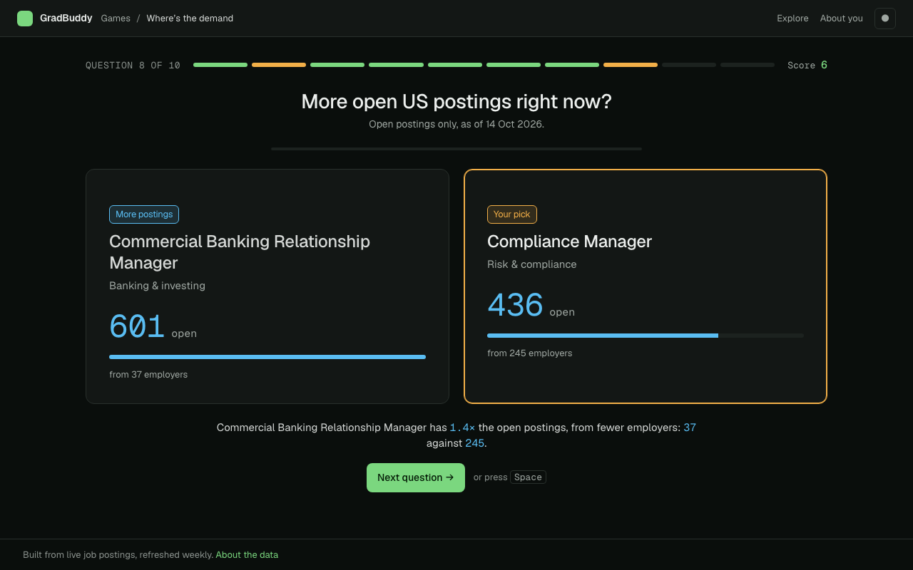
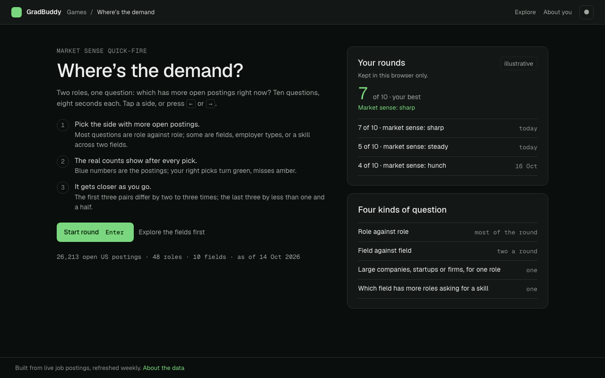
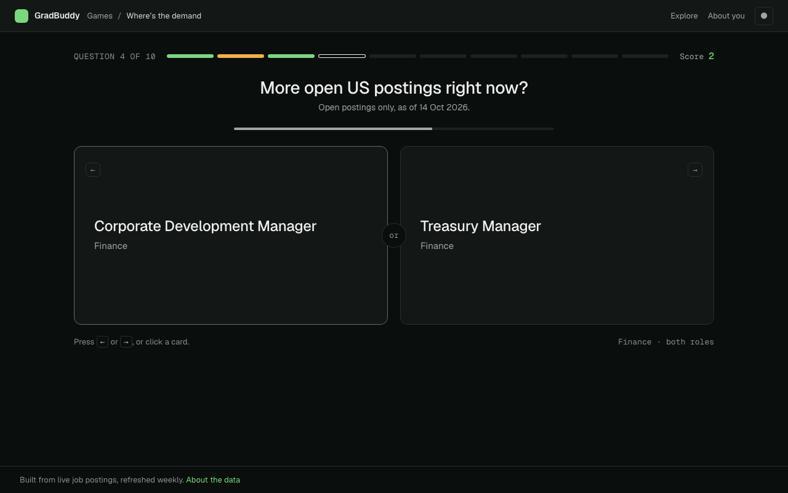
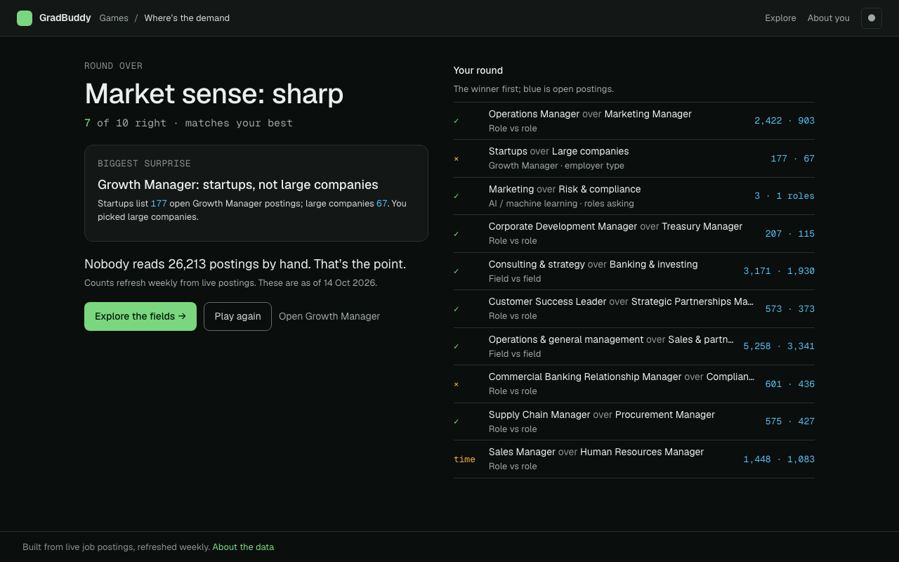

# Where's the demand

```json
{ "slug": "wheres-the-demand", "title": "Where's the demand", "tagline": "Guess where the open jobs are", "cover": "img/games/wheres-the-demand.png", "status": "soon" }
```

A market-sense quick-fire. Two cards, one question: "More open US postings right now: Corporate Development
Manager or Treasury Manager?" Tap a side (or press ← / →), see the real counts, and move on. Ten questions, eight
seconds each, about a minute a round. The round ends with a rank title, the biggest surprise of the round, and
a way into the fields on Explore.



Every number in this file and in the mocks was computed from `web/data/graph_mba.json` (meta `generated`
2026-10-14), its role files in `web/data/graph_mba/` and `web/data/graph.json` (meta `generated` 2026-10-11) by a
script run while this was written. The only things marked "illustrative" are a player's past rounds on the start
screen, which no data file can hold.

## Contents

1. [Pitch](#pitch) · 2. [Why it's fun](#why-its-fun) · 3. [Rules](#rules) · 4. [A round step by step](#a-round-step-by-step) ·
5. [Question types](#question-types) · 6. [Choosing pairs](#choosing-pairs) · 7. [Difficulty](#difficulty) ·
8. [Scoring and rank titles](#scoring-and-rank-titles) · 9. [End screen and punchline](#end-screen-and-punchline) ·
10. [Into the atlas](#how-it-sends-people-into-the-atlas) · 11. [Data sources](#data-sources) · 12. [Edge cases](#edge-cases) ·
13. [Keyboard and accessibility](#keyboard-and-accessibility) · 14. [Persistence](#persistence) · 15. [Out of scope](#out-of-scope) ·
16. [Open questions](#open-questions-for-the-owner) · 17. [Effort](#effort-estimate) · 18. [Mocks](#mocks)

## Pitch

MBA and grad students carry a mental map of where the jobs are, picked up from classmates, recruiting events and
the employers who come to campus. That map is often wrong. Banks hire relationship managers in numbers few people
expect. Startups post more Growth Manager roles than large companies do. Corporate development has nearly twice
the open postings of treasury. The game puts that map up against 26,213 open US postings for 48 roles, one
pair at a time, and shows how far off it is.

The point of the game is the atlas's point: nobody can keep a live picture of 26,213 postings in their head, and
the counts change every week.

## Why it's fun

Taken from what works in infisical.com/403:

- **One verb, one rule.** Pick the side with more open postings. No setup, no reading.
- **Short rounds that tighten.** Ten questions in about a minute. The early pairs are far apart (two to three
  times) and the last pairs are close (under one and a half times), so the round gets harder as it goes and the
  last three questions are the ones people remember.
- **The reveal is the reward.** Each pick flashes two real numbers. "601 open, from 37 employers" teaches
  something whether you were right or not.
- **Stakes that last.** A personal best and the last five rounds, kept in the browser.
- **A rank title instead of a number.** "Market sense: sharp" is something you can screenshot and send to a
  classmate. "7/10" is not.
- **An ending that makes the product's point.** "Nobody reads 26,213 postings by hand. That's the point."

It suits MBA and grad students because the roles are the ones they recruit for (consulting, banking, corporate
finance, marketing, operations) and the question is one they argue about anyway: where are the jobs?

## Rules

1. A round has 10 questions. Each shows two cards and a question ("More open US postings right now?").
2. Pick a card: click it, or press ← for the left card and → for the right.
3. You have 8 seconds. The timer is soft: running out costs you that question's point, never the round. The bar
   turns amber for the last 3 seconds.
4. After a pick (or when time runs out) both counts show in blue. Your pick is outlined green if it was right,
   amber if it was not.
5. One point for each right pick. No points for speed, no penalty for wrong answers beyond the lost point.
6. Ties never appear: two sides with the same count are never paired.

## A round step by step

1. **Start screen** (`#/play/wheres-the-demand`). Title, three rules, the data line ("26,213 open US postings · 48
   roles · 10 fields · as of 14 Oct 2026"), Start round (Enter), your best and your last rounds, and a "No timer"
   switch (see [accessibility](#keyboard-and-accessibility)). While this screen is shown the round is built in the
   background (index already loaded; one or two role files for the employer-type question).
2. **Question 1 to 3** (easy, ratio 2 to 3 times). One role pair, one employer-type question, one skill question,
   in random order.
3. **Question 4 to 7** (medium, 1.5 to 2 times). Two role pairs and two field pairs, in random order.
4. **Question 8 to 10** (hard, 1.2 to 1.5 times). Three role pairs.
5. **Each question**: the cards appear with no numbers; the 8-second bar runs; the player picks or the time runs
   out; the counts show (blue, with a bar in proportion and the number of employers for a role), the verdict
   tags show ("Your pick · right" in green, "Your pick" in amber, "More postings" on the winning card when it is
   not yours), and one line says what the gap was: "Commercial Banking Relationship Manager has 1.4× the open
   postings, from fewer employers: 37 against 245." Next question with Space, Enter or the button. The answer stays
   up until the player moves on (no auto-advance; reading the numbers is the point).
6. **Results**: the rank title, the score, the biggest surprise, the punchline, the data date, and three ways out:
   Explore the fields → (`#/explore`), Play again, and Open <the surprise's role>. On the right, the round recap: ten
   rows, winner first, both counts in blue.

## Question types

All MBA counts are US postings (the atlas shows the United States only for the MBA set; `meta.country` is
"United States") and open postings only (`n_open`).

| Type | Prompt | A card shows | The count | Per round |
|---|---|---|---|---|
| Role vs role | More open US postings right now? | Role label; its field as text | `M.roles[id].n_open` | 6 |
| Field vs field | Which field has more open US postings? | Field label; "N roles" | Sum of `n_open` over the field's roles (the same number as the Explore circle) | 2 |
| Employer type | Growth Manager: where are more of the open US postings? | "Large companies" / "Startups" / "Consulting, banks and funds" (the atlas's own labels) | Open postings in that role's file whose employer type matches | 1 |
| Skill across fields | More roles where most postings ask for AI / machine learning? | Field label; "of N roles" | Roles of the field where the skill's company-balanced share is at least one half (the top row of the role screen's skill grid) | 1 |

Notes per type:

- **Role vs role** is the core. 43 roles are eligible: the 48 MBA roles the atlas shows, less the five with
  `small: true` (under 60 postings: Digital Transformation Manager, Real Estate Development Manager, M&A
  Integration Manager, Real Estate Acquisitions Associate, Venture Capital Associate). Two roles in the same field
  make the best questions (Corporate Development Manager 207 against Treasury Manager 115, both Finance); the
  picker prefers them (see below).
- **Field vs field** uses the 10 MBA fields. The Product field is left out in v1: its count on Explore (8,765) is
  worldwide and from another refresh (2026-10-11), so it is not comparable with the US MBA fields. See
  [open question 2](#open-questions-for-the-owner).
- **Employer type** is the one that surprises most: Growth Manager has 177 open US postings at startups and 67 at
  large companies; Investment Banking Associate 429 at consulting firms, banks and funds against 192 at large
  companies. It needs one role file, so there is one per round.
- **Skill across fields** is the "which field has more roles asking for X" question. It is counted in roles, not
  postings, because the index holds shares, not per-posting counts, and a share times a count is an estimate, not
  a count. To keep it fair to small fields, a pair is used only when the field with more roles asking also has the
  larger share of its roles asking (Marketing: 3 of 4 roles; Risk & compliance: 1 of 3). Generic skills
  (`Atlas.genericSkills()`, asked by most postings in half the roles, such as communication) are left out because
  every field has them.

Not in v1: product role vs product role, and product role vs MBA role (see [open question 2](#open-questions-for-the-owner)).

## Choosing pairs

The aim is pairs that are not obvious: never Operations Manager (2,422) against Venture Capital Associate (19).

**Ratio band.** The larger count divided by the smaller is between 1.2 and 3, and inside the band of the
question's slot ([Difficulty](#difficulty)). Below 1.2 the answer is a coin toss (and a weekly refresh can flip
it); above 3 nobody learns anything.

**How many pairs exist** (data of 2026-10-14):

| Pool | Easy, 2 to 3× | Medium, 1.5 to 2× | Hard, 1.2 to 1.5× |
|---|---|---|---|
| Role pairs (43 eligible roles) | 190 (17 in the same field) | 133 (10 in the same field) | 109 (11 in the same field) |
| Field pairs (10 fields) | 9 | 8 | 10 |
| Employer-type questions, either side at least 10 postings | 30 in all, across roles and bands | | |
| Skill-across-fields questions (count and share agree) | 145 in all, over 21 skills | | |

So a player can play many rounds before a role pair repeats, but field pairs repeat after a few rounds. That is
acceptable: the field questions are two of ten.

**Rules for a round:**

1. No role or field appears on a card twice in a round (a skill question's field cards count as fields).
2. Prefer same-field role pairs: when one exists in the slot's band and has not been used, pick it with
   probability one half. Same-field pairs are the ones a student thinks they know.
3. Prefer surprising pairs: one role pair in the round, when available, is a "concentrated" pair, where the side
   with more postings has fewer employers (90 such pairs exist; for example Commercial Banking Relationship Manager
   601 open from 37 employers against Compliance Manager 436 from 245). These make the best "biggest surprise".
4. The winner's side (left or right) is random, 50/50, so position carries no signal.
5. If a slot's pool is empty (after a data refresh), widen the band by 0.1 at a time towards 1.2 or 3; if still
   empty, take a role pair from any band; never a tie, never a ratio under 1.1.
6. Random per round with `Math.random`; a `?seed=<n>` hash parameter makes a round reproducible for tests.

**Employer type, in detail.** At round start pick a random eligible MBA role, load its file
(`Atlas.fetchJson("data/" + role.file)`), count open postings by `Atlas.employerType(job)` (`large`, `startup`,
`firm`), and take the pair of types whose ratio is in the slot's band with at least 10 postings on each side. If the
role has none, try another role (up to three files), then fall back to a role pair. Role files average about 0.6 MB
(the largest MBA role shown, Operations Manager, is 2.65 MB); prefer roles whose `bytes` is under 1.5 MB.

## Difficulty

| Questions | Band (larger ÷ smaller) | Mix |
|---|---|---|
| 1 to 3 | 2 to 3 | 1 role, 1 employer type, 1 skill (shuffled) |
| 4 to 7 | 1.5 to under 2 | 2 roles, 2 fields (shuffled) |
| 8 to 10 | 1.2 to under 1.5 | 3 roles |

The timer stays at 8 seconds all round; difficulty comes from the gap closing, not from the clock. (A shrinking
clock was considered; it makes the last questions a reflex test rather than a market-sense test, and the counts
need a moment to read.)

## Scoring and rank titles

One point per right pick, out of 10. The rank title is the headline of the results screen:

| Score | Rank title |
|---|---|
| 0 to 2 | Market sense: warming up |
| 3 to 4 | Market sense: hunch |
| 5 to 6 | Market sense: steady |
| 7 to 8 | Market sense: sharp |
| 9 | Market sense: keen |
| 10 | Market sense: uncanny |

Random picking scores 5 on average, so "steady" is the coin-toss band and "sharp" needs real knowledge. Below the
title: "7 of 10 right · matches your best" (or "new best", or "best: 8").

## End screen and punchline

- **Rank title and score**, as above.
- **Biggest surprise**, computed, first rule that applies:
  1. Among the questions the player got wrong (not timed out), the one with the largest ratio: the market
     disagreed with them most. In the mock: "Growth Manager: startups, not large companies. Startups list 177 open
     Growth Manager postings; large companies 67. You picked large companies."
  2. Else (no wrong picks), a pair in the round where the winner had fewer employers than the loser: "Commercial
     Banking Relationship Manager: 601 open postings from 37 employers."
  3. Else, the field with the fewest open postings seen in the round: "Risk & compliance: 1,101 open, the smallest
     field you saw."
- **Punchline**: "Nobody reads 26,213 postings by hand. That's the point." The number is `meta.n_open` at render
  time, never hard-coded.
- **Data line**: "Counts refresh weekly from live postings. These are as of 14 Oct 2026." (`meta.generated`).
- **Ways out**: Explore the fields → (`#/explore`, primary), Play again, and Open <role of the surprise>
  (`#/role/<id>`; for a field surprise, `#/field/<group>`).
- **Recap** on the right: ten rows, winner first ("Supply Chain Manager over Procurement Manager"), the type of
  question beneath, both counts in blue, a green ✓, an amber × or an amber "time".

### What "right now" means

The counts are as of the last refresh, not live. Every question says so under the prompt ("Open postings only, as
of 14 Oct 2026") and so does the end screen. The prompt keeps the words "right now" because they are true to within a
week, but the date is always on screen. If `meta.generated` is more than 10 days before today, the start screen adds
"last refreshed N days ago" in amber, so a stale deploy does not pretend to be current.

### Open postings only

The game counts open postings (`n_open`), which is what the atlas lists and what Explore sizes its circles by.
Closed postings (674 in the MBA set) stay in the atlas's skill shares for a year but are never listed, so the
game never counts them. The one exception is the skill question, which uses shares, and shares include recently
closed postings exactly as the skill grid does. Its prompt is about roles, not postings, so no count of postings
is shown for it.

## How it sends people into the atlas

- The primary button on the results screen is "Explore the fields →" (`#/explore`), where the same field counts
  are circles.
- "Open <role>" goes to the role screen of the biggest surprise, where the player can see what that role asks for.
- On each answer, the role names could link to `#/role/<id>` with a middle click or after the round; in the round
  itself they are not links (a stray click must not leave the game).
- The start screen's quiet link "Explore the fields first".

## Data sources

| What | File | Field(s) | How it is computed | Loaded by |
|---|---|---|---|---|
| Role counts (MBA) | `web/data/graph_mba.json` | `roles[id].n_open`, `.n_companies`, `.label`, `.group`, `.small`, `.file`, `.bytes` | Read directly | `Atlas.index()` → `ix.M.roles` |
| Field counts | same | `groups[]` (`id`, `label`, `families`) | Sum of `n_open` over `families`; equals `ix.groups[k].nOpen` | `Atlas.index()` → `ix.groups` (skip `product`) |
| Data date, country, totals | same | `meta.generated` ("2026-10-14"), `meta.country` ("United States"), `meta.n_open` (26,213), `meta.n_jobs` (26,887), `meta.n_companies` (1,489) | Read directly | `ix.M.meta` |
| Employer type for one role | `web/data/graph_mba/<role>.json` | `jobs[].group`, `jobs[].open` | Count jobs with `open !== false` by `Atlas.employerType(j)` | `Atlas.fetchJson("data/" + r.file)` |
| Skill across fields | `web/data/graph_mba.json` | `skills[].by_family[role]`, `skills[].cluster`, `skills[].name` | For each field: roles (non-small) where `by_family[role] >= Atlas.TIER.core` (0.5). Checked: `by_family` equals the company-balanced share the grid computes from the role file (Business Operations Manager, AI / machine learning: 0.621 both ways) | `ix.M.skills`; exclude `cluster === "credentials"`, ids starting `yoe_`, and `Atlas.genericSkills()` |
| Product counts (not in v1) | `web/data/graph.json` (9.4 MB) | `jobs[].family`, `.country`, `.group`; `meta.generated` ("2026-10-11") | Count jobs per family (all are open; the product set drops closed postings). US only: `country === "United States"` (6,015 of 8,765) | `Atlas.product()`, lazily |

**Reuse from `web/atlas.js`:** `Atlas.index()`, `Atlas.fetchJson()`, `Atlas.employerType()`,
`Atlas.EMPLOYER_TYPES` (for the labels), `Atlas.TIER.core`, `Atlas.genericSkills()`, and `Atlas.product()` if
product questions are added. No new loader.

**Read MBA role counts from `ix.M.roles`, not `ix.roles`.** The product set has a family with the id `pmm`
(Product Marketing Manager), and so does the MBA Marketing field. `Atlas.product()` writes the product family into
`ix.roles.pmm`, so once the product set is loaded `ix.roles.pmm.nOpen` is 812 (worldwide, product set) instead of
the MBA role's 613 (US). `ix.M.roles.pmm.n_open` is always 613. Key every card by set and id.

**Product set, if added later.** `graph.json` is about 9.4 MB, so never load it to start a round. Start
`Atlas.product()` when the start screen opens (the Explore screen does the same) and include a product question
only if it has resolved by the time the round is built. Do not precompute a new data file: the build thread may
not change data, and a hand-made file would go stale on the next refresh.

**Real pairs used in the mocks** (all from the files above):

| # | Type | Winner | Loser | Ratio |
|---|---|---|---|---|
| 1 | Role | Operations Manager 2,422 | Marketing Manager 903 | 2.68 |
| 2 | Employer type | Growth Manager at startups 177 | at large companies 67 | 2.64 |
| 3 | Skill (AI / machine learning) | Marketing, 3 of 4 roles | Risk & compliance, 1 of 3 | 3.0 |
| 4 | Role | Corporate Development Manager 207 | Treasury Manager 115 | 1.80 |
| 5 | Field | Consulting & strategy 3,171 | Banking & investing 1,930 | 1.64 |
| 6 | Role | Customer Success Leader 573 | Strategic Partnerships Manager 373 | 1.54 |
| 7 | Field | Operations & general management 5,258 | Sales & partnerships 3,341 | 1.57 |
| 8 | Role | Commercial Banking Relationship Manager 601 (37 employers) | Compliance Manager 436 (245 employers) | 1.38 |
| 9 | Role | Supply Chain Manager 575 | Procurement Manager 427 | 1.35 |
| 10 | Role | Sales Manager 1,448 | Human Resources Manager 1,083 | 1.34 |

The mock player's picks (7 right, one wrong at 2 and 8, a time-out at 10) are invented to show the states.

## Edge cases

- **Data not loaded or failed.** The start button waits on `Atlas.index()`; on failure, the atlas's normal error
  message and a link back to the games.
- **Employer-type file slow or failed.** Replace the question with a role pair; never block the round on it.
- **A refresh changes the counts.** Pairs are built from whatever data is loaded; nothing is cached across
  sessions except the score history, which stores the data date of each round.
- **Pools run dry** after a refresh (few pairs in a band): widen the band as in [Choosing pairs](#choosing-pairs).
- **Same count on both sides.** Never paired.
- **Same counts by coincidence across rounds**: fine.
- **Tab hidden mid-question.** Pause the timer on `visibilitychange`; resume when visible.
- **Double input** (click and key together): the first pick locks the question.
- **Pick in the last frame of the timer**: the pick wins if its event arrives before the timeout handler runs.
- **Long role labels** ("Corporate Strategy Analyst or Associate", "Commercial Banking Relationship Manager"):
  the card title wraps to two lines; the recap row ellipsises.
- **localStorage blocked** (private mode): the game plays; no best is shown; no error.
- **Theme.** The mocks are dark; light comes from the tokens with no extra work.
- **Leaving mid-round** (back button, hash change): the round is dropped, nothing saved.

## Keyboard and accessibility

- ← picks the left card, → the right. Enter starts a round and moves to the next question; Space also moves on.
  Escape on a question screen asks nothing and goes back to the start screen (the round is dropped).
- Both cards are real `<button>`s in reading order (left then right), with accessible names like
  "Corporate Development Manager, Finance".
- An `aria-live="polite"` region announces each result: "Right. Corporate Development Manager 207 open, Treasury
  Manager 115 open." and "Out of time." The timer bar is `aria-hidden`; a screen reader user hears "8 seconds per
  question" once, on the start screen.
- **Timing adjustable (WCAG 2.2.1).** A "No timer" switch on the start screen turns the timer off for the round;
  the rank title is shown the same way. Remember the choice with the score history.
- Colour is never the only signal: the verdicts are words ("Your pick · right", "Your pick", "More postings") and
  the recap marks are ✓, × and "time".
- `prefers-reduced-motion`: no count-up on the numbers, no bar animation; they appear at their final values.
- Focus: after an answer, focus moves to Next question; after Next, to the left card.
- Desktop only, like the rest of the atlas; no phone layout.

## Persistence

`localStorage` only, key `game.wheres-the-demand`, every read and write in `try/catch`:

```json
{ "best": 7, "bestAt": "2026-10-18", "untimed": false,
  "rounds": [{ "score": 7, "rank": "sharp", "at": "2026-10-18", "data": "2026-10-14", "untimed": false }] }
```

Keep the last 5 rounds (the "Your rounds" panel on the start screen). Untimed rounds are listed but do not set the
best. Nothing is sent anywhere.

## Out of scope

- Leaderboards across players, accounts, sharing images, anything server-side.
- Live counts (the game reads the weekly files).
- Phone layout.
- Product set questions in v1 (see open question 2).
- Levels (entry vs senior) and locations as question types; they are good follow-ups ("More open entry-level
  postings: …") once the core is played.
- Any change to the matcher, the taxonomy, the pipeline or the data files.

## Open questions for the owner

**1. Standalone game or a mini-round inside other games?**

- **A. Standalone, with a mini-round entry point for later (recommended).** Its own route, start screen and end
  screen, as specified here. The module also exposes `WheresTheDemand.miniRound({ n: 3 })`, which returns three
  questions and a result, so another game (Higher or lower, Skill path) can drop in a three-question bonus later
  without rework. Tradeoff: one more card in the carousel; slightly more code for the export.
- **B. Standalone only.** Simplest; if a mini-round is wanted later it is a refactor.
- **C. Mini-round only**, inside Higher or lower (which asks the same kind of "which is more" question about
  skills). Fewer cards in the carousel, but no rank title of its own and no ending that makes the market point;
  it would be a side dish.

**2. Product roles in the game?**

- **A. Not in v1 (recommended).** MBA roles and fields only: one country, one data date, no 9.4 MB load. Product
  is still one click away on Explore.
- **B. Product vs product only, US counts.** Lazily loaded; only four product pairs are in band (Technical Program
  Manager 1,225 against Product Marketing Manager 590; Product Marketing Manager 590 against Product Owner 250;
  Product Owner 250 against Product Operations 104; Product Owner 250 against Product Analyst 96), all easy. At
  most one per round, with its own date (11 Oct 2026) under the prompt.
- **C. Product and MBA roles mixed, US counts.** Most variety, but two data dates in one question, and the product
  US counts would differ from the worldwide number Explore shows for Product (8,765), which looks like a bug to a
  player who checks.

**3. The skill question: keep it, and how to count it?**

- **A. Keep it, counted in roles, with the share check (recommended).** Exact numbers, one per round.
- **B. Count estimated postings** (share × open postings). Feels more like "demand", but the number is an estimate
  and would need "about" on screen, against the rule that counts are real.
- **C. Drop it.** Keeps the game purely about posting counts; loses the one question that touches skills.

**4. Same round for everyone each week?**

- **A. Random each round (recommended).** Replay value; best score is personal.
- **B. One seeded round per data refresh** ("this week's round", seed = `meta.generated`), with free play after.
  Classmates can compare scores on the same questions; it needs a second mode on the start screen.

## Effort estimate

About one and a half days for one person with the atlas in hand:

- Pair builder (pools, bands, rules, fallbacks, seed): half a day.
- Screens (start, question, answer, results) and styles on the tokens: half a day.
- Keyboard, live region, untimed mode, reduced motion, persistence: a quarter day.
- Integration (route, games.json, cover), checks, PR: a quarter day.

## Mocks

Standalone HTML at 1280×800 on the real tokens (`../../../web/tokens/styles.css`) and `web/style.css`, with a PNG of
each. The game's own classes (`.wd-*`) are in a `<style>` block in each mock; the build moves them into
`web/style.css`.

**01 Start.** Rules, the data line, your rounds (illustrative), the four kinds of question.



**02 Question.** Question 4 of 10: Corporate Development Manager or Treasury Manager. Progress, score, the
8-second bar, the two cards with their key hints.



**03 Answer.** Question 8: the player picked Compliance Manager (amber); Commercial Banking Relationship Manager
has more (601 against 436, from 37 employers against 245). This is the cover.


**04 Results.** Market sense: sharp, 7 of 10, the biggest surprise, the punchline, the recap.



`cover.png` is a copy of `03-answer.png`; the build copies it to `web/img/games/wheres-the-demand.png`.
